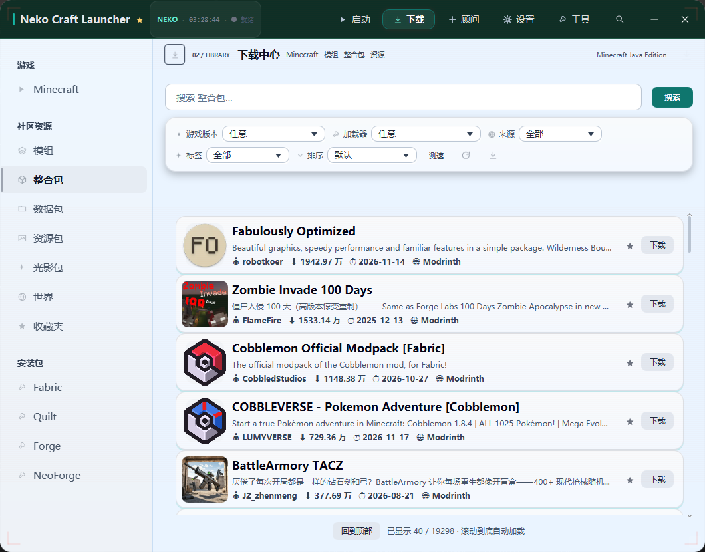
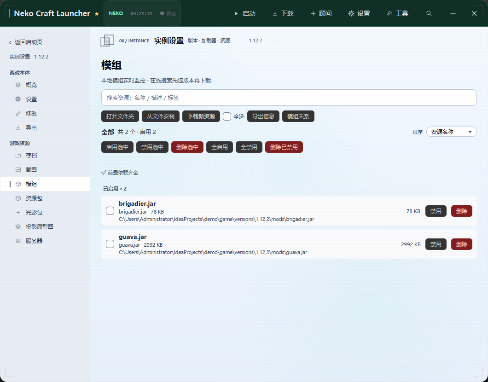
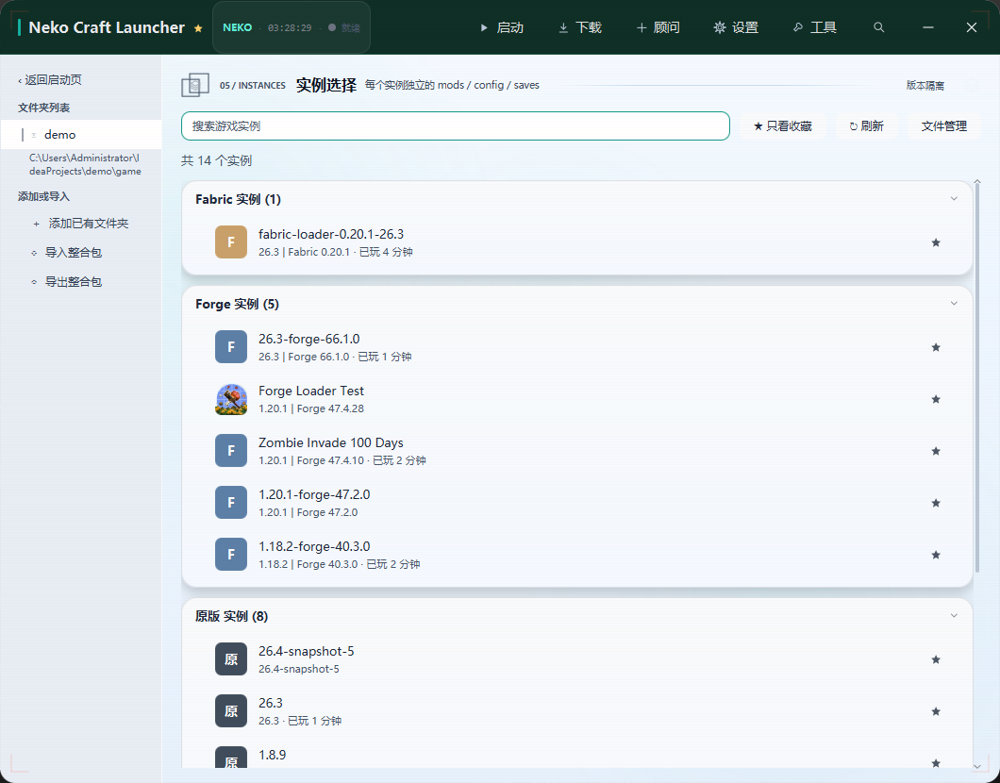
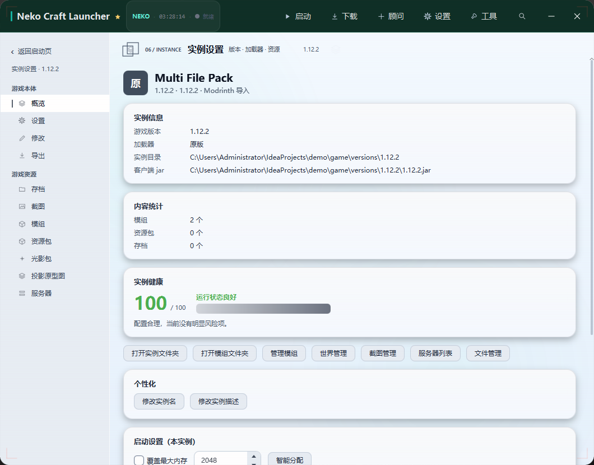
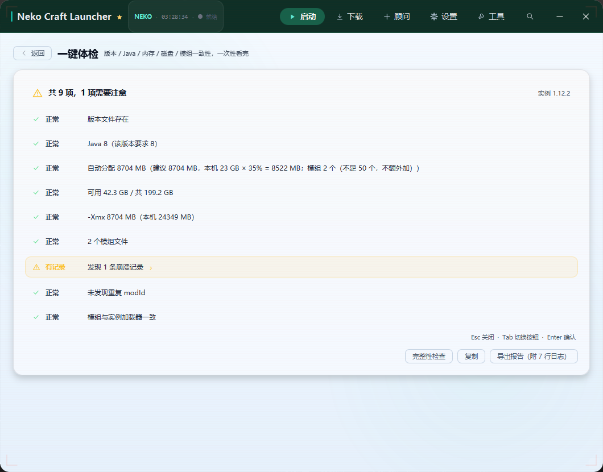
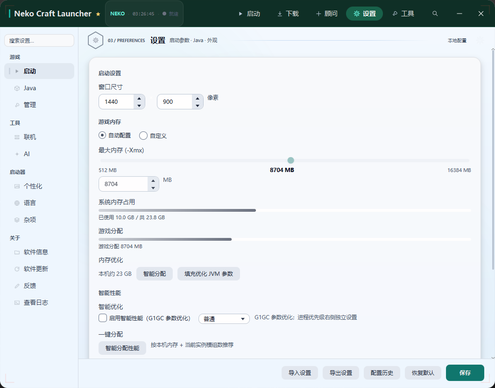
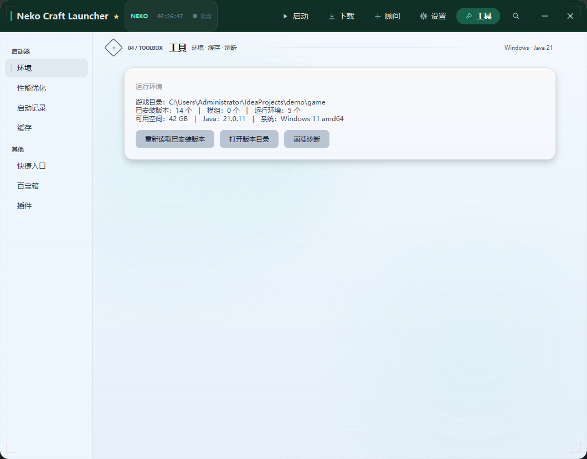
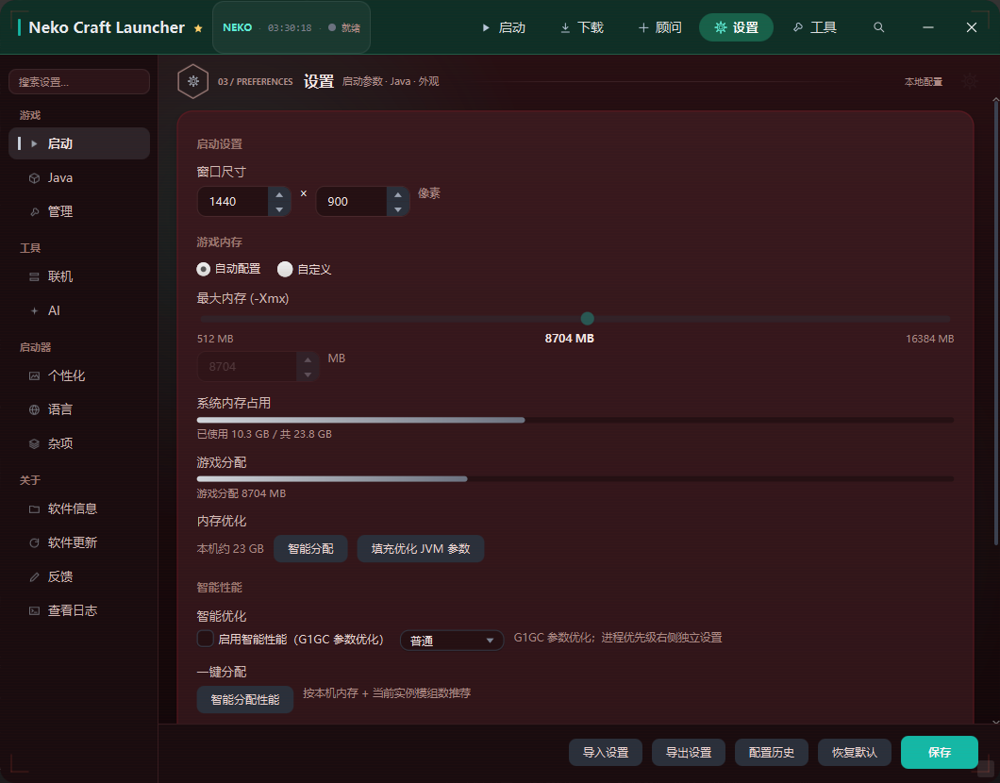

# Neko Craft Launcher 功能预览

> 适用版本：2.9.1（Windows 10/11 x64，安装版 / 免安装版二选一）
> 状态说明：✅ 已上线　🧪 实验/部分可用　🗓 计划中
> 截图：全部由 `docs/images/preview/` 下的实机截图生成（本机 1060×830 窗口，浅色 + 深色两套）

---

## 1. 启动与实例

| 功能 | 状态 | 说明 |
|---|---|---|
| 一键启动 | ✅ | 启动按钮按当前实例启动，实时输出日志与进度 |
| 实例选择 | ✅ | 按加载器分组（原版 / Fabric / Forge / NeoForge / Quilt），支持搜索、收藏、只看收藏 |
| 实例隔离 | ✅ | 版本隔离可全局或按实例覆盖，mods/config/saves 互不污染 |
| 启动记录 | ✅ | 每次启动的结果、准备耗时、游玩时长写入历史，成功率可视化 |
| 启动前预检 | ✅ | Java、内存、堆大小、磁盘空间、崩溃记录在启动前给出建议 |
| 启动失败兜底 | ✅ | 页面构建异常自动回退启动页并记录原因，不白屏 |
| 启动脚本导出 | ✅ | 导出可复现问题的启动脚本 |

## 2. 下载与安装

| 功能 | 状态 | 说明 |
|---|---|---|
| 整合包浏览 | ✅ | Modrinth / CurseForge 双源，来源可切换，失败自动切镜像 |
| 模组 / 资源包 / 数据包 / 光影包 | ✅ | 分类浏览、搜索、按版本与加载器筛选 |
| 一键安装整合包 | ✅ | 下载 → 解析 → 落地，支持 `.mrpack` / `.zip` |
| 整合包导入 / 导出 | ✅ | 本地文件导入、当前实例打包导出 |
| 安装器（Fabric/Forge/NeoForge/Quilt） | ✅ | 独立安装页：选版本 → 选加载器版本 → 安装，含加载器适配预检 |
| 安装进度页 | ✅ | 准备 / 下载 / 安装分步展示，失败可重试 |
| 下载任务管理 | ✅ | 任务列表、进度、速度、取消 |
| 下载镜像测速 | ✅ | 一键测 Modrinth / MCIM / CurseForge 延迟并自动选最快 |

## 3. 模组管理

| 功能 | 状态 | 说明 |
|---|---|---|
| 本地模组列表 | ✅ | 实时监控 mods 目录，自动刷新 |
| 模组详情 | ✅ | 读取 jar 内 `fabric.mod.json` / `mods.toml`：名称、版本、加载器、描述；悬停看完整路径 |
| 在线搜索安装 | ✅ | 独立「在线模组」页，搜索 → 选版本 → 安装 |
| 依赖检查 | ✅ | 扫描前置依赖，缺失标记「缺前置」，可一键补装 |
| 冲突检查 | ✅ | 重复 modId / 跨加载器冲突提示 |
| 更新检测 | ✅ | 有新版时行内出现「更新」按钮 |
| 批量操作 | ✅ | 全选、启用/禁用选中、删除选中、全启用、全禁用、删除已禁用 |
| 导出清单 | ✅ | 导出 `logs/mods-info.txt` |
| 模组关系 | ✅ | 弹窗展示前置依赖扫描结果 |

## 4. 实例选择与实例设置

| 页签 | 状态 | 说明 |
|---|---|---|
| 概览 | ✅ | 实例信息、内容统计、健康分、快捷入口、个性化、启动设置、高级管理 |
| 设置 | ✅ | 窗口尺寸、内存、JVM / Java / 游戏参数、版本隔离（可继承全局） |
| 修改 | ✅ | 实例名、描述、实例 ID（只读） |
| 导出 | ✅ | 导出启动脚本 / 打包实例 |
| 存档 / 截图 / 资源包 / 光影包 / 投影 / 服务器 | ✅ | 目录管理、安装文件、打开目录、世界管理与截图管理 |
| 文件管理 | ✅ | 内置目录浏览器，可切换实例目录 |

## 5. 健康与诊断

| 功能 | 状态 | 说明 |
|---|---|---|
| 一键体检（独立页面） | ✅ | 9 项：版本文件、Java、内存、磁盘、堆、模组数、崩溃记录、重复 modId、加载器一致性 |
| 告警行跳转 | ✅ | 点告警直接打开崩溃目录 / mods 目录 / 设置页 |
| 复制报告 | ✅ | 一键复制到剪贴板（含最近日志），冒烟会校验内容 |
| 导出报告 | ✅ | 写入 `game/logs/health-check-*.txt`，附带 N 行日志 |
| 完整性检查 | ✅ | 校验版本 JSON / 客户端 jar / 资源索引 |
| 崩溃分析 | ✅ | 解析 crash-reports，给出可能原因 |
| 自动修复 | ✅ | 缺文件补全、核心修复 |
| 配置历史 | ✅ | 关键设置改动留档，可恢复 |

## 6. 顾问与记录

| 功能 | 状态 | 说明 |
|---|---|---|
| 启动顾问页 | ✅ | 建议卡 + 稳定性统计 + 最近 5 条异常 + 打开日志/崩溃目录 + 一键体检 |
| 稳定性画像 | ✅ | 启动次数、崩溃次数、成功率、平均准备耗时 |
| 概览三卡 | ✅ | 启动记录 / 最近一次启动 / 累计游玩，可点击跳顾问页 |
| 全部记录 | ✅ | 启动历史页（工具 → 启动记录），可查每次结果与耗时 |

## 7. 账号与皮肤

| 功能 | 状态 | 说明 |
|---|---|---|
| 正版登录 | ✅ | Microsoft 账号（OAuth 设备码流程） |
| 登录线路容错 | ✅ | 微软 OAuth 三条公共主机别名先并行探测、按实测延迟选最快；连接失败 / 超时 / 5xx / 429 / 应用被拒都会自动切换下一条，`authorization_pending` 等业务结果不换线；详见 `docs/AUTH-ENDPOINTS.md` |
| 线路体检 | ✅ | 命令栏 `线路`（别名 `auth` / `line`）逐条探测六个阶段的接口并打印延迟 |
| 外置登录 | ✅ | authlib-injector（LittleSkin 等） |
| 离线账号 | ✅ | 本地用户名启动 |
| 账号管理 | ✅ | 多账号切换、删除、失效提示 |
| 皮肤预览 | ✅ | 3D 皮肤 / 披风预览、上传、切换 |
| 头像 | ✅ | 支持自定义头像与模式切换 |

## 8. AI 助手

| 功能 | 状态 | 说明 |
|---|---|---|
| DeepSeek 在线问答 | ✅ | 命令栏输入，结合启动器上下文回答 |
| 本地助手 | ✅ | 未填 Key 时用本地规则助手，仍可回答常见问题 |
| Key 入口 | ✅ | 命令栏「密钥」按钮一键跳到 设置 → AI |
| 模组查找指令 | ✅ | 「找 xx 模组」会去 Modrinth 搜索并给出安装入口 |

## 9. 设置与工具

| 页签 | 状态 | 说明 |
|---|---|---|
| 环境 | ✅ | 硬件、系统、Java 扫描与安装（可下载运行时） |
| 性能优化 | ✅ | 电源计划、Game DVR、游戏模式、透明效果四项可逆优化，改动前自动备份 |
| 启动记录 | ✅ | 历史列表、成功率、耗时统计 |
| 缓存 | ✅ | 缓存体积统计与清理 |
| 快捷入口 | ✅ | 常用目录/网页/命令 |
| 百宝箱 | ✅ | 便携服务端、端口/网络诊断等小工具 |
| 插件 | ✅ | 插件目录与加载状态（扩展点） |

## 10. 界面与交互

| 能力 | 状态 | 说明 |
|---|---|---|
| 集成式页面 | ✅ | 启动 / 下载 / 顾问 / 设置 / 工具 / 实例 / 体检统一为应用内页面，无系统弹窗堆叠 |
| 深浅主题 | ✅ | 双主题变量，卡片/按钮/输入框/悬浮态一致 |
| 动效 | ✅ | 默认线性过渡；设置里可关闭（关闭后悬停提亮一起停用） |
| 悬停/按压反馈 | ✅ | 导航、卡片、按钮、列表行均有反馈 |
| 键盘可达 | ✅ | Tab 遍历、Enter 确认、Esc 关闭；弹窗打开即聚焦首个动作 |
| 命令面板 | ✅ | `Ctrl+K` 搜索命令 / 页面，↑↓ 选择，Enter 执行 |
| 快捷启动 | ✅ | `F1` 启动页、`F2` 实例、`F3` 实例设置、`F5` 下载、`F6` 设置、`F7` 工具、`F9` 日志 |
| 圆角自检 | ✅ | 页面切换后自动修复「圆角底 + 方角边」的节点 |

### 深色主题与悬停反馈（本轮实机复核）

悬停前后对照（深色主题 · 设置页卡片）：

实测悬停像素差异（窗口内采样区 440×180，隔 2px 采样）：

| 采样点 | 窗口内坐标 | 悬停差异像素 |
|---|---|---|
| 设置页卡片 | 600, 220 | 2654 |
| 设置页左侧导航项 | 60, 397 | 1682 |
| 顶栏「工具」按钮 | 947, 27 | 427 |

## 11. 工程质量（供维护者）

| 项 | 状态 |
|---|---|
| 编译告警 | 0 |
| 单元测试 | 278 项全绿（含 22 项登录线路容错测试） |
| 架构守卫 | core 113 类 / 12 包，0 处 javafx、ui、入口依赖；ui 77 类 |
| CI 一键链 | `scripts/ci.ps1`：构建 → 单测 → 架构守卫 → 冒烟 → 视觉基线 |
| 冒烟覆盖 | 页面切换、安装页面板、体检复制、悬停差异、键盘可达 |
| 视觉基线 | 夜间比对 + 差异热力图 + 左右对照，失败自动留证据 |

---

## 尚未完成 / 已知限制

| 项 | 说明 |
|---|---|
| 🧪 运行时代码签名 | 未签名，首次运行可能出现 SmartScreen 提示 |
| ✅ 深色主题悬停 | 已复核：卡片 / 导航项 / 顶栏按钮三处均有实测差异（见上表） |
| 🧪 骨架屏 | 已实现，加载过快时看不到 |
| 🗓 插件生态 | 目录与加载点已就位，尚无第三方插件 |
| 🗓 多语言 | 目前中文界面，`LanguageConfig` 已有基础结构 |
