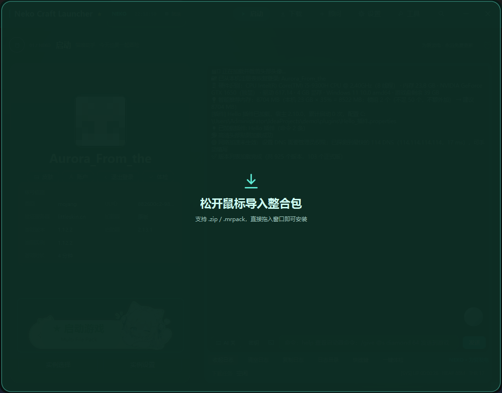
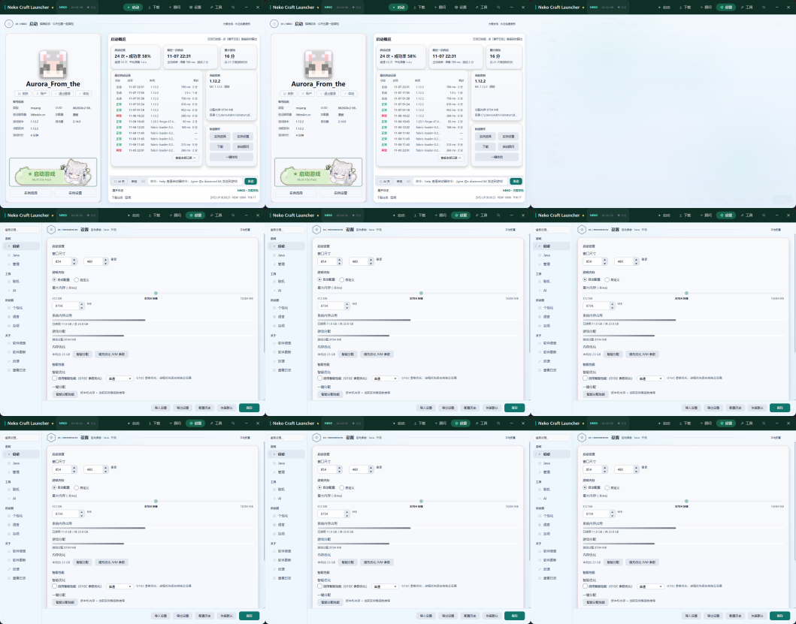

# 动效系统

> 2.14.0 起，动效不再是「一条线性曲线打天下」：按用途分了缓动曲线，并补齐了
> 水波、拖拽触发、弹窗/吐司入场等交互反馈。全部动效只改渲染属性（opacity / translate /
> scale / effect），不触发布局，主线程开销可控。

## 1. 曲线

| 名字 | 曲线 | 用在哪 |
|---|---|---|
| `Motion.OUT` | `cubic-bezier(0.16, 1, 0.30, 1)`（ease-out-expo） | 入场、位移、淡入 |
| `Motion.IN_OUT` | `cubic-bezier(0.65, 0, 0.35, 1)` | 往返、退出、吐司淡出 |
| `Motion.SPRING` | `cubic-bezier(0.34, 1, 0.64, 1)` | 按压回弹、卡片悬停 |
| `Motion.EMPHASIS` | `cubic-bezier(0.20, 0, 0, 1)` | 页面过渡、弹窗入场 |

> JavaFX 的 `Interpolator.SPLINE` 控制点必须落在 `[0,1]`，写 `1.56` 会直接抛
> `IllegalArgumentException: Control point coordinates must all be in range [0,1]`（踩过）。

时长（`FAST 120ms / NORMAL 210ms / SLOW 420ms`）统一乘 `animationSpeed`，设置里可整体关闭。

## 2. 交互反馈

| 场景 | 实现 | 观感 |
|---|---|---|
| 按钮按下 | `Motion.press` → 缩到 0.986 + **水波扩散** | 点击有落点反馈，不是纯缩放 |
| 卡片悬停 | `Motion.hoverCard` → 放大 1.006 + 上浮 2px + 阴影扩散 | 卡片浮起来，不是只换底色 |
| 页面切换 | 淡入 + 方向滑入 + **0.985 → 1 缩放**，`EMPHASIS` | 前进/后退有方向感 |
| 弹窗 | `Motion.dialogIn`：0.94 → 1 + 淡入；关闭 0.96 缩回 | 弹出有重量 |
| 吐司 | 从上方 12px 滑下 + `SPRING` 收尾 | 提示有落点感 |
| 列表/卡片批量 | `stagger`：每张延迟 40ms 交错入场 | 页面不是「啪」一下全出来 |

## 3. 拖入文件安装（触发动画）

拖拽文件进窗口时：

1. `DRAG_OVER` → 提示层淡入，盒子开始 **呼吸缩放**（0.985 ↔ 1.012，760ms 往返），
   下载图标 **上下弹跳** 4 次；
2. 标题与副标题错开 60/140ms 进场，形成层次；
3. `DRAG_DROPPED` → `Motion.dropConfirm`：盒子向上顶到 1.06 再淡出，随后进入原有安装流程。

自检开关：`-Dmc.dropDemo=1` 启动后 2.6 秒自动展示提示层（正常启动不触发），用于截图与冒烟。

## 4. 自检与回归

| 手段 | 检查什么 |
|---|---|
| `scripts/capture-motion.ps1 -ContactSheet` | 连拍帧 → 九宫格，确认过渡真的逐帧发生 |
| `scripts/capture-motion.ps1 -MinHoverDiff` | 悬停差异低于阈值判失败 |
| `scripts/smoke-test.ps1` | 页面切换 + 悬停差异区间 + 键盘可达 |
| `-Dmc.dropDemo=1` | 拖拽提示层的视觉回归 |

页面过渡连拍（26 帧，点击「设置」时抓拍）：

## 5. 关闭动画

设置 → 个性 → 动效开关（`config.animations=false`）。关闭后所有 `Motion.*` 直接返回，
不注册监听器、不起 Timeline；切换页面立即完成并回调，不影响功能。
