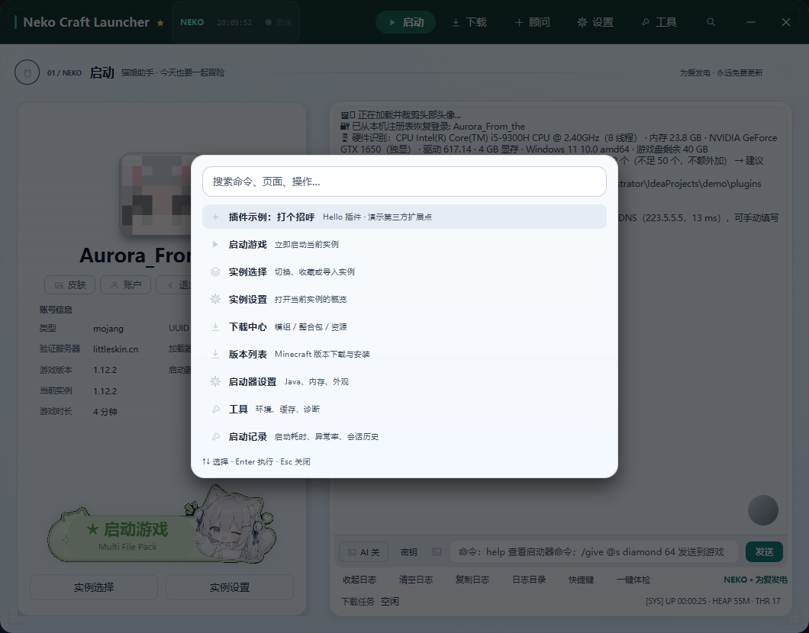

# 插件

> 状态：扩展点可用，仓库里带一个可编译的示例插件（`plugins-samples/hello-plugin`）。

## 1. 机制

- 插件是普通 jar，放在 `plugins/`（程序目录或数据目录，二者都会扫）；
- 通过 `ServiceLoader` 发现 `com.example.demo.core.plugin.NekoPlugin` 实现；
- 加载失败只会在日志里记一行，不影响启动器本身；
- 插件能做的事目前只有两件：写日志、往命令面板（`Ctrl+K`）加一条命令。
  界面、启动流程不开放 —— 先保证插件不会把主流程改坏。

```java
public interface NekoPlugin {
    String id();
    String name();
    void init(PluginContext context) throws Exception;
}
```

`PluginContext` 提供 `log(String)`、`dataDir()`、`addCommand(title, hint, action)`。

## 2. 示例插件

源码：[`plugins-samples/hello-plugin`](../plugins-samples/hello-plugin)

```powershell
# 前提：先构建启动器本体（产生 target\mc-launcher.jar）
.\mvnw.cmd package -DskipTests
.\plugins-samples\hello-plugin\build.ps1
# → plugins\hello-plugin.jar
```

启动后：

| 位置 | 现象 |
|---|---|
| 启动日志 | `🔌 已加载插件: Hello 插件`、`Hello 插件已加载，宿主版本 2.10.0，数据目录 …` |
| 命令面板 `Ctrl+K` | 第一条就是 `插件示例：打个招呼 / Hello 插件 · 演示第三方扩展点` |
| 执行该命令 | 日志出现 `你好，我是插件 example.hello，宿主是 Neko Craft Launcher 2.10.0` |



## 3. 写自己的插件

1. 新建一个 Java 项目，依赖启动器 jar（`compileOnly`）：
   ```powershell
   javac -encoding UTF-8 -cp target\mc-launcher.jar -d build\classes src\**\*.java
   ```
2. 在 `src/META-INF/services/com.example.demo.core.plugin.NekoPlugin` 里写实现类全名；
3. 打包：`jar --create --file plugins\my-plugin.jar -C build\classes .`；
4. 重启启动器，日志里应出现 `🔌 已加载插件: 你的名字`。

## 4. 边界

- 插件运行在启动器进程内，没有沙箱：只装自己信任的 jar；
- API 目前是 1.0 形状，`NekoPlugin` 只加方法不删方法；
- 插件异常会被 `PluginManager` 捕获并记录，但不能阻止主流程，所以插件里别做长时间阻塞操作。
