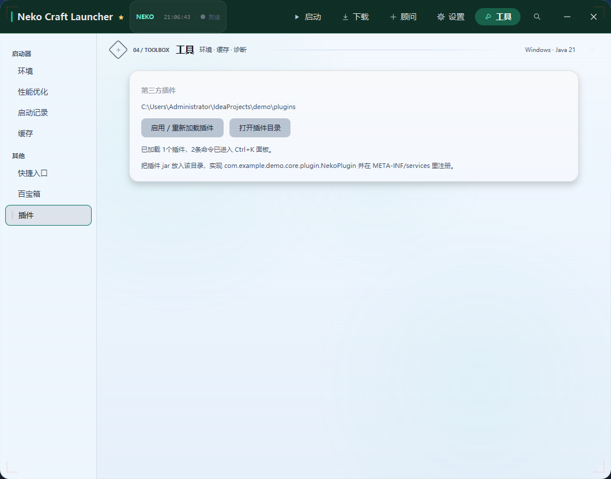

# 插件

> 状态：扩展点可用，仓库里带一个可编译的示例插件（`plugins-samples/hello-plugin`）。

## 1. 机制

- 插件是普通 jar，放在 `plugins/`（程序目录或数据目录，二者都会扫）；
- 通过 `ServiceLoader` 发现 `com.example.demo.core.plugin.NekoPlugin` 实现；
- 加载失败只会在日志里记一行，不影响启动器本身；
- 插件能做四件事：写日志、往命令面板（`Ctrl+K`）加命令、订阅宿主事件、读写自己的配置文件。
  界面与启动流程不开放 —— 先保证插件不会把主流程改坏。

```java
public interface NekoPlugin {
    String id();
    String name();
    void init(PluginContext context) throws Exception;
}
```

`PluginContext` 提供 `log()`、`dataDir()`、`addCommand(title, hint, action)`、`on(hook, listener)`、`config()`。

### 事件钩子

| 钩子 | 何时触发 | payload |
|---|---|---|
| `LAUNCH_START` | 游戏进程即将启动 | 实例 id |
| `LAUNCH_FINISH` | 游戏进程已退出 | 实例 id |
| `PAGE_SWITCH` | 页面过渡动画完成 | 页面 key（`launch` / `download` …） |

钩子是「只通知、不干预」：回调抛异常会被吞掉并记一行 `⚠ 插件 X 在钩子上出错`，
其它插件与主流程照常。回调在宿主线程同步执行，别在里面写盘或联网。

### 配置

```java
PluginConfig config = context.config();   // <数据目录>/plugins/<插件名>.properties
int launches = config.getInt("launches", 0);
config.putInt("launches", launches + 1);
boolean saved = config.save();            // 返回 false 表示磁盘只读/被占用
```

## 2. 示例插件

源码：[`plugins-samples/hello-plugin`](../plugins-samples/hello-plugin)

```powershell
# 前提：先构建启动器本体（产生 target\mc-launcher.jar）
.\mvnw.cmd package -DskipTests
.\plugins-samples\hello-plugin\build.ps1
# → plugins\hello-plugin.jar
```

启动后：

| 位置 | 现象 |
|---|---|
| 启动日志 | `🔌 已加载插件: Hello 插件（命令 2 条）`、`[插件] Hello 插件已加载，宿主 2.11.0，累计启动 0 次，配置 …\plugins\Hello_插件.properties` |
| 命令面板 `Ctrl+K` | `插件示例：打个招呼`、`插件示例：启动计数` |
| 切换页面 | `[插件] 切到页面：download`（`PAGE_SWITCH` 钩子） |
| 启动一次游戏 | `[插件] 实例 1.12.2 开始启动（第 1 次）`，计数写进插件自己的 properties |


## 2.1 插件页显示的插件数与命令数



## 3. 写自己的插件

1. 新建一个 Java 项目，依赖启动器 jar（`compileOnly`）：
   ```powershell
   javac -encoding UTF-8 -cp target\mc-launcher.jar -d build\classes src\**\*.java
   ```
2. 在 `src/META-INF/services/com.example.demo.core.plugin.NekoPlugin` 里写实现类全名；
3. 打包：`jar --create --file plugins\my-plugin.jar -C build\classes .`；
4. 重启启动器，日志里应出现 `🔌 已加载插件: 你的名字`。

## 4. 边界

- 插件运行在启动器进程内，没有沙箱：只装自己信任的 jar；
- API 目前是 1.0 形状，`NekoPlugin` 只加方法不删方法；
- 插件异常会被 `PluginManager` 捕获并记录，但不能阻止主流程，所以插件里别做长时间阻塞操作。
