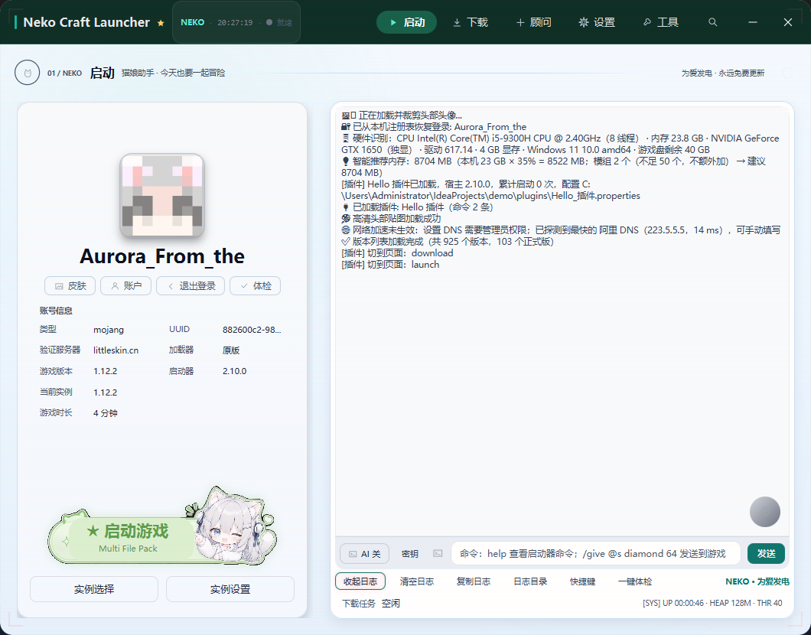

# Neko Craft Launcher 2.11.0

> 2.10.0 之后的收口版：把「插件只有命令」「多语言只有壳层」「Xbox 线路不可配」这三件
> 半成品补成能用的东西，并把文案欠账变成可度量的数字。

## 安装包

| 文件 | 说明 |
|---|---|
| `NekoCraftLauncher-2.11.0.exe` | **安装版**：双击安装，可选目录，开始菜单 + 桌面快捷方式（按用户安装） |
| `NekoCraftLauncher-2.11.0-win64.zip` | 免安装版，解压双击 `NekoCraftLauncher.exe` |
| `NekoCraftLauncher-2.11.0-Features.pdf` / `.docx` | 功能预览（图文版） |
| `SHA256SUMS.txt` | 全部产物的 SHA256，一行一个，可直接 `sha256sum -c` |
| `verify.txt` / `neko-codesign.cer` | 签名校验报告与自签名公钥 |

exe 与 jar 均已签名（自签名 + DigiCert 时间戳）。

## 1. 插件：从「只能加命令」到「能订阅事件、能存配置」

| 能力 | API |
|---|---|
| 命令面板 | `context.addCommand(title, hint, action)` |
| 事件钩子 | `context.on(PluginHook.LAUNCH_START / LAUNCH_FINISH / PAGE_SWITCH, listener)` |
| 自己的配置 | `context.config()` → `get/getInt/put/putInt/save`，落在 `plugins/<插件名>.properties` |

安全边界：钩子异常被吞掉并记日志，一个坏插件既不能让游戏启动失败，也影响不到别的插件；
回调在宿主线程同步执行，文档里写明别在里面做耗时操作。

示例插件 `plugins-samples/hello-plugin` 升级成三个能力全用：统计启动次数并落盘、
页面切换打点。实机日志：

```
[插件] Hello 插件已加载，宿主 2.11.0，累计启动 0 次，配置 …\plugins\Hello_插件.properties
🔌 已加载插件: Hello 插件（命令 2 条）
[插件] 切到页面：download
[插件] 切到页面：launch
```



## 2. 多语言：从「壳层」到「有守卫的工程」

- 顶栏、运行状态、按钮之外，**页面标题**也接进 `I18n`（启动 / 下载中心 / 实例选择 /
  实例设置 / 启动顾问 / 体检 / 世界）；
- 新增 `scripts/i18n-report.ps1`：清点界面里还没走 i18n 的中文字面量，导出
  `build/i18n-report.csv`（文件 / 行号 / 原文），可直接交给翻译；
- 新增基线 `scripts/i18n-baseline.json` 与 `I18nCoverageTest`：**只降不升**——
  新页面若继续写 `new Label("中文")`，单测与 CI 都会失败；
- `ci.ps1` 增加「界面文案基线」一步，失败信息直接告诉你怎么改。

当前欠账 **2269 条 / 66 个文件**（`HelloApplication` 536、`SettingsPanel` 325、
`ToolsPanel` 257 居前）。数字是诚实的，翻译一条就少一条。

## 3. Xbox / XSTS / Minecraft 端点可配置

官方这四步只有一条地址，现在允许挂自建镜像，进同一套「先探测、失败切换」逻辑：

```bat
set JAVA_TOOL_OPTIONS=-Dmc.auth.xstsUrl=https://mirror.example.net/xsts/authorize
```

| 属性 | 默认地址 |
|---|---|
| `mc.auth.xboxLiveUrl` | `user.auth.xboxlive.com/user/authenticate` |
| `mc.auth.xstsUrl` | `xsts.auth.xboxlive.com/xsts/authorize` |
| `mc.auth.minecraftLoginUrl` | `api.minecraftservices.com/authentication/login_with_xbox` |
| `mc.auth.profileUrl` | `api.minecraftservices.com/minecraft/profile` |

官方地址永远优先，只接受 `https://`，镜像挂了不影响正常用户。

## 工程质量

- 编译 0 告警；单元测试 **308 项全绿**（+19：插件钩子 6、插件配置 6、端点镜像 4、文案守卫 3）
- 架构守卫通过：core 125 类 / 13 包，0 处 javafx / ui / 入口依赖
- 文案基线守卫：`2269 ≤ 2269` PASS
- 发布链：`mvnw package` → `jarsigner` → `package-exe -SkipBuild` → `package-installer -SkipBuild`
  → `sign-release -SkipJar` → `SHA256SUMS.txt`

## 校验

```
1cc75e323963db075d03054e40b6b8da857b27971644303e0dddc6f9310cc7e5  NekoCraftLauncher-2.11.0.exe
49c80cff437d4f299ea3c5eacf585d4ed0a257bec50e537f920505b945070689  NekoCraftLauncher-2.11.0-win64.zip
3dd41f31b0731eebdec7d06d6018df3d9997d0064149f4d6448cb043b8034ec9  NekoCraftLauncher-2.11.0-Features.pdf
b9568a7ae098b13c42874610bc01cf71b712f448846299397115ebbfadeaa44d  NekoCraftLauncher-2.11.0-Features.docx
41bdc7658bd42ee52d59d81ccd541597b7deac9e600715ab23327227a73cdb89  neko-codesign.cer
257b8376013673cdae48d20dfdb3bba0e9636627f12d4d5ba8c14cfaddc871da  verify.txt
```
