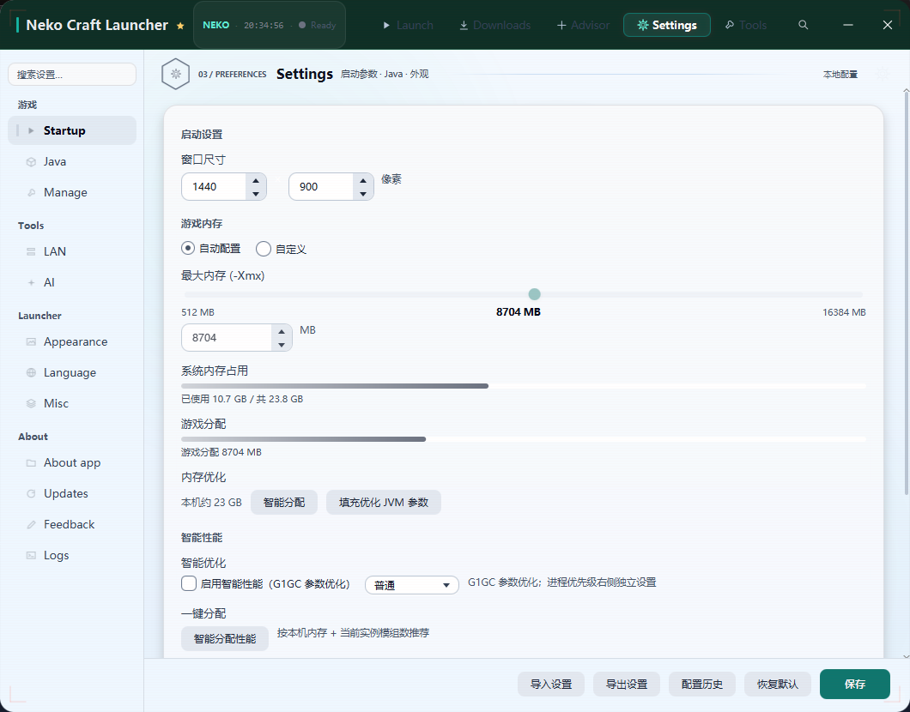

# Neko Craft Launcher 2.12.0

> 补完 2.11.0 的最后一件事：英文界面能完整导航了 —— 三套页签（设置 12 / 工具 7 / 实例设置 11）
> 全部走语言包，并顺手把「中文当 map key」这个隐患拆掉。

## 安装包

| 文件 | 说明 |
|---|---|
| `NekoCraftLauncher-2.12.0.exe` | **安装版**：双击安装，可选目录，开始菜单 + 桌面快捷方式（按用户安装） |
| `NekoCraftLauncher-2.12.0-win64.zip` | 免安装版，解压双击 `NekoCraftLauncher.exe` |
| `NekoCraftLauncher-2.12.0-Features.pdf` / `.docx` | 功能预览（图文版） |
| `SHA256SUMS.txt` | 全部产物 SHA256，`sha256sum -c` 可直接校验 |
| `verify.txt` / `neko-codesign.cer` | 签名报告与自签公钥 |

exe 与 jar 均已签名（自签名 + DigiCert 时间戳）。

## 1. 页签也能跟着语言变了

以前三个侧栏把**中文标签直接当 map key**（`tabPages.put("语言", …)`、`select("启动记录")`），
想翻译就得连 key 一起改。这次把 key 与标签拆开：

```java
tabItem("language");                 // key：稳定、与语言无关
Label text = new Label(tabLabel(key));   // 标签：I18n.t("settings.tab.language", "语言")
selectTab(tabKey("查看日志"));        // 老入口（F8 / 启动失败提示）仍传中文，自动映射
```

结果（实机截图）：



| 侧栏 | 英文页签 |
|---|---|
| 设置 | Startup / Java / Manage / LAN / AI / Appearance / Language / Misc / About app / Updates / Feedback / Logs |
| 工具 | Environment / Performance / Launch history / Cache / Shortcuts / Toolbox / Plugins |
| 实例设置 | Overview / Settings / Rename / Export / Saves / Screenshots / Mods / Resource packs / Shader packs / Schematics / Servers |

分组标题（游戏/工具/启动器/关于、启动器/其他）一并进了语言包。

## 2. 文案欠账继续下降

| 指标 | 2.11.0 | 2.12.0 |
|---|---|---|
| 界面里的中文字面量 | 2269 | **2205** |
| 语言包条目 | 60 | 60（页签 key 并入） |

新页签若还想写死中文，`I18nCoverageTest` 与 `ci.ps1` 的「界面文案基线」会直接拦住。
清单仍在 `build/i18n-report.csv`（文件 / 行号 / 原文），翻译一条少一条。

## 3. 顺手修掉的隐患

- 页签 key 不再依赖中文：以后改文案不会悄悄把页面映射弄丢；
- `openTab("查看日志")` / `openTab("AI")` 这类老调用保持可用（中文→key 自动映射），F8 与
  启动失败提示不需要跟着改；
- 搜索过滤的关键字表也跟着变了 key，并且把**当前语言的标签**并入匹配串 —— 英文界面下搜
  "logs" 也能命中 Logs 页签。

## 工程质量

- 编译 0 告警；单元测试 **308 项全绿**
- 架构守卫 PASS（core 125 类 / 13 包，0 处 javafx / ui / 入口依赖）
- 文案基线 `2205 ≤ 2205` PASS
- 新增断言：设置/工具/实例设置三套页签的英文条目必须存在且不含中文

## 校验

```
71f2091882c32ee7728cea3bca0360abe43ef8b97b5951ce3bbebc86ea448b2f  NekoCraftLauncher-2.12.0.exe
13711db81d008a36059d3a47d0a3ca4bdec4d6eed7a5376ed487c39eb69d7be0  NekoCraftLauncher-2.12.0-win64.zip
50668582482ae7f0b5ed3571c69083bf90718bab3101899e3a9d81d4cea387d0  NekoCraftLauncher-2.12.0-Features.pdf
340e7824929b9af89a5ec8d74ad5113a515702892feba6da2003437f34c9009b  NekoCraftLauncher-2.12.0-Features.docx
41bdc7658bd42ee52d59d81ccd541597b7deac9e600715ab23327227a73cdb89  neko-codesign.cer
40d921bd59500d02151b844cb647438e1ac850a0c80af8c29f56764e0a2388a9  verify.txt
```
