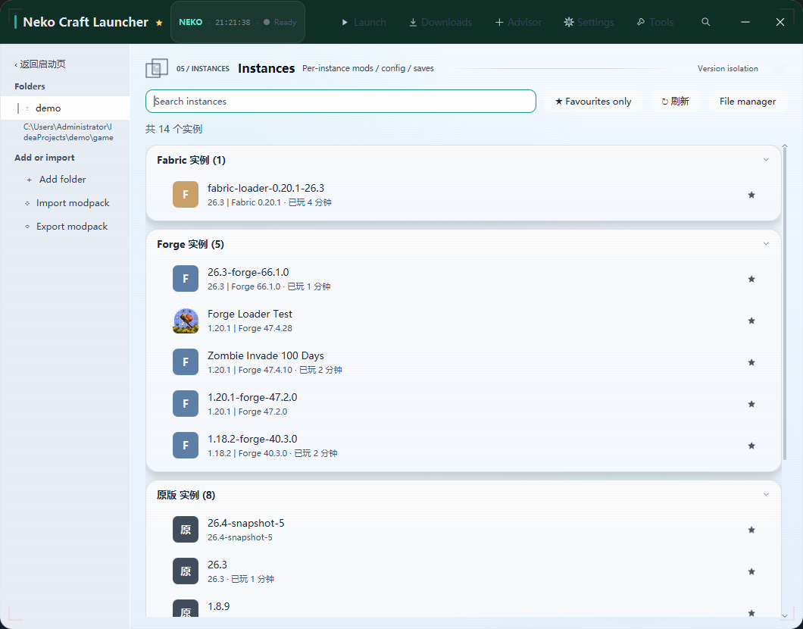

# Neko Craft Launcher 2.13.1

> 两条线一起推进：深色主题逐页复核补齐到 9 个界面；正文翻译开始按页推进
> （实例选择页完成），并把「中文当 key」的写法固化成约定与守卫。

## 安装包

| 文件 | 说明 |
|---|---|
| `NekoCraftLauncher-2.13.1.exe` | **安装版**：双击安装，可选目录，开始菜单 + 桌面快捷方式（按用户安装） |
| `NekoCraftLauncher-2.13.1-win64.zip` | 免安装版，解压双击 `NekoCraftLauncher.exe` |
| `NekoCraftLauncher-2.13.1-Features.pdf` / `.docx` | 功能预览（图文版） |
| `SHA256SUMS.txt` | 全部产物 SHA256，`sha256sum -c` 可直接校验 |
| `verify.txt` / `neko-codesign.cer` | 签名报告与自签公钥 |

## 1. 深色主题逐页复核（3 → 9 个界面）

新增 6 张实机截图，覆盖：顾问、工具、实例选择、实例设置、模组管理、一键体检；
加上此前的启动 / 下载 / 设置，**9 个界面**都在深色下肉眼过了一遍，没有出现浅底白字或不可读的对比度。

| 界面 | 深色截图 |
|---|---|
| 实例选择 | `docs/images/preview/24-dark-instances.png` |
| 模组管理 | `docs/images/preview/26-dark-mods.png` |
| 一键体检 | `docs/images/preview/27-dark-health.png` |

## 2. 正文翻译开始按页推进：实例选择页

10 条文案进语言包，英文界面实测：

```
Folders / Add or import / Add folder / Import modpack / Export modpack
Search instances / ★ Favourites only / 刷新 / File manager / Version isolation
Per-instance mods / config / saves
```



欠账 **2185 → 2175**。

## 3. 新增 `docs/I18N.md`，把约定写死

- 两种写法：壳层用 `I18n.t("key", "中文")`；正文用 `I18n.t("中文")`（中文当 key，缺英文时自动回退）；
- **踩过的坑**：`.properties` 的 key 不能含未转义空格 —— `★ 只看收藏=…` 会被解析成 key `★`，
  必须写成 `★\ 只看收藏=…`；
- 守卫口径：两种包裹形式都算「已处理」，其余中文字面量算欠账；`i18n-report.ps1` + `I18nCoverageTest` + CI 同步。

## 工程质量

- 编译 0 告警；单元测试 **308 项全绿**
- 架构守卫 PASS；文案基线 `2175 ≤ 2175` PASS
- 完整 CI（含冒烟 + 视觉基线）在 2.13.0 上已跑通，本轮只改了文案与资源

## 校验

```
6e25d9d08765653471f86aeaa1eedb134d4d4ff91bf74130b53c859a224d92c1  NekoCraftLauncher-2.13.1.exe
eb6c82e4c07134fe71e71c073186fdca63c2cb6463c68724541f9bd4959ef4ae  NekoCraftLauncher-2.13.1-win64.zip
76e9c61ac742660538e4e460bd99f8097f95451d6c237a59f0e56f90261156c4  NekoCraftLauncher-2.13.1-Features.pdf
bc025918f1d0f232d2e74749a725290cf55e834b0c8586ef83ca5780e355adc6  NekoCraftLauncher-2.13.1-Features.docx
41bdc7658bd42ee52d59d81ccd541597b7deac9e600715ab23327227a73cdb89  neko-codesign.cer
6179011d807cf12278f0338a896851b6a27f7122b6b5c62a50118b6ec789acfc  verify.txt
```
