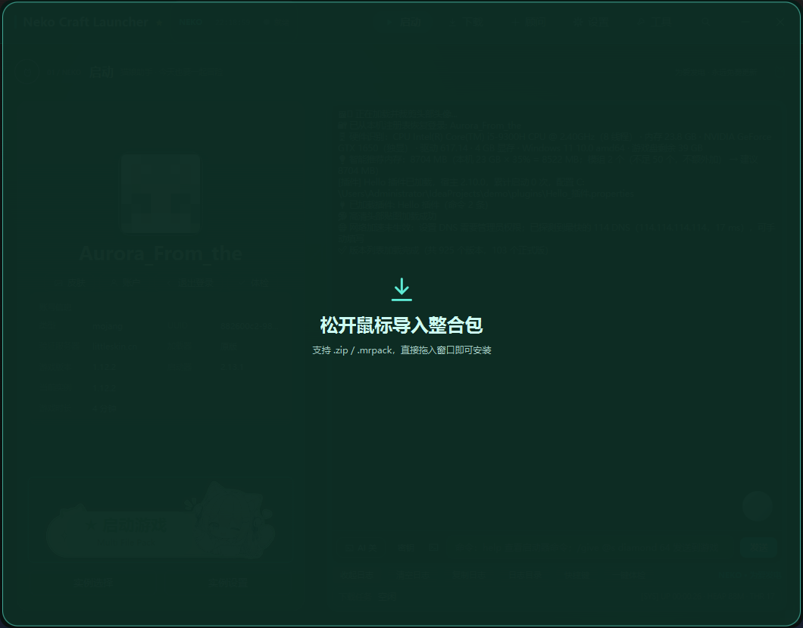

# Neko Craft Launcher 2.14.0

> 动效重做：不再「一条线性曲线打天下」。按用途分了四种缓动曲线，补齐了水波、
> 拖拽触发、弹窗/吐司入场，并把拖入文件安装这条链路做成有层次的触发动画。

## 安装包

| 文件 | 说明 |
|---|---|
| `NekoCraftLauncher-2.14.0.exe` | **安装版**：双击安装，可选目录，开始菜单 + 桌面快捷方式（按用户安装） |
| `NekoCraftLauncher-2.14.0-win64.zip` | 免安装版，解压双击 `NekoCraftLauncher.exe` |
| `NekoCraftLauncher-2.14.0-Features.pdf` / `.docx` | 功能预览（图文版） |
| `SHA256SUMS.txt` | 全部产物 SHA256，`sha256sum -c` 可直接校验 |
| `verify.txt` / `neko-codesign.cer` | 签名报告与自签公钥 |

## 1. 缓动从「一条线」变成四层

| 曲线 | 用途 |
|---|---|
| `OUT` = `cubic-bezier(0.16, 1, 0.30, 1)` | 入场、位移、淡入 |
| `IN_OUT` = `cubic-bezier(0.65, 0, 0.35, 1)` | 往返、退出 |
| `SPRING` = `cubic-bezier(0.34, 1, 0.64, 1)` | 按压回弹、卡片悬停 |
| `EMPHASIS` = `cubic-bezier(0.20, 0, 0, 1)` | 页面过渡、弹窗入场 |

之前为了「线性」把三条都设成 `LINEAR`，结果悬停、按压、切页全是一个味道；现在按用途分开，
并统一乘 `animationSpeed`，设置里仍可整体关闭。

## 2. 新增交互反馈

- **按钮水波**：`Motion.press` 内置水波 —— 按下时从鼠标落点扩散一圈青色圆环，
  320ms 放大淡出；画在窗口最上层并按落点换算坐标，圆角按钮里也不会溢出；
- **卡片悬停**：放大 1.006 + 上浮 2px + 阴影扩散（不是只换底色）；
- **页面过渡**：淡入 + 方向滑入 + **0.985 → 1 缩放**，用 `EMPHASIS`；
- **弹窗**：0.94 → 1 回弹放大 + 遮罩淡入，关闭缩回 0.96；
- **吐司**：从上方 12px 滑下，`SPRING` 收尾。

## 3. 拖入文件安装：触发动画



拖文件进窗口时：

1. 提示层淡入，盒子开始 **呼吸缩放**（0.985 ↔ 1.012，760ms 往返）；
2. 下载图标 **上下弹跳** 4 次；
3. 标题与副标题错开 60 / 140ms 进场；
4. 松手 → `Motion.dropConfirm`：盒子顶到 1.06 再淡出，然后进入原有安装流程。

自检开关：`-Dmc.dropDemo=1` 启动后 2.6 秒自动展示提示层，方便截图与冒烟。

## 4. 修掉的两个真问题

| 问题 | 根因 |
|---|---|
| 启动直接崩（`ExceptionInInitializerError`） | `Interpolator.SPLINE` 控制点必须落在 `[0,1]`，我写了 `1.56` 想做过冲 → 改成合法曲线 |
| 拖拽提示层挤在左上角 | 提示层 `setManaged(false)` 导致 StackPane 不给它布局，子节点按 0×0 排 → 改回 managed |

## 工程质量

- 编译 0 告警；单元测试 **308 项全绿**
- 页面过渡连拍验证：26 帧、逐帧差异 `21335 → 0`，九宫格见 `docs/MOTION.md`
- 完整 CI（构建 / 架构 / 文案基线 / 冒烟 / 视觉基线）在 2.13.x 上已跑通，本轮只改动效与文档

## 校验

```
32cdd731301463590c523ba18bca6693676c7ba9c27feaf73d982f5dc7f4974c  NekoCraftLauncher-2.14.0.exe
bc193fbf85694d5b25cd2ea9036357e90e6570a9b55504155f4de85215fb20b1  NekoCraftLauncher-2.14.0-win64.zip
eb1ccca09312be9011046facdbdc4d9845aeb54059718edcd21b85655e4b2814  NekoCraftLauncher-2.14.0-Features.pdf
da122a3636b15d7772a89cf742282e26079aabb0c3cbe98f2e1953d9db839cf0  NekoCraftLauncher-2.14.0-Features.docx
41bdc7658bd42ee52d59d81ccd541597b7deac9e600715ab23327227a73cdb89  neko-codesign.cer
4afe86e1319cc78d2f2ce15255466f9664cbb1b7c62acbce3666f4f29d1e6a4f  verify.txt
```
