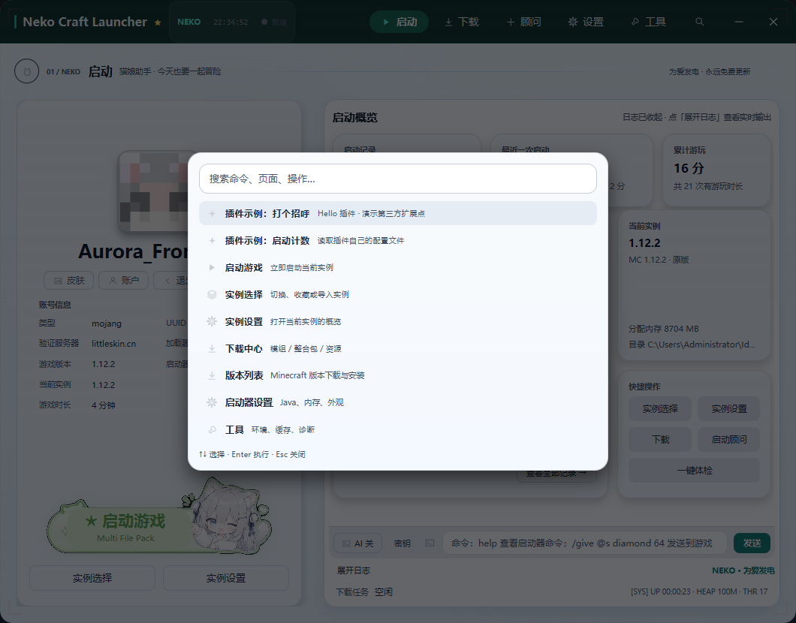

# Neko Craft Launcher 2.15.0

> 2.14.0 动效的续篇：列表逐行入场、安装进度环、页面方向感、命令面板逐项浮现、
> 头像/皮肤交叉淡入。四件事都落在同一条 `Motion` 上，不再各写各的。

## 安装包

| 文件 | 说明 |
|---|---|
| `NekoCraftLauncher-2.15.0.exe` | **安装版**：双击安装，可选目录，开始菜单 + 桌面快捷方式（按用户安装） |
| `NekoCraftLauncher-2.15.0-win64.zip` | 免安装版，解压双击 `NekoCraftLauncher.exe` |
| `NekoCraftLauncher-2.15.0-Features.pdf` / `.docx` | 功能预览（图文版） |
| `SHA256SUMS.txt` / `verify.txt` / `neko-codesign.cer` | 校验与签名材料 |

## 1. 列表逐行入场（不再整块「啪」地出现）

`Motion.staggerRows(rows, 24, 12)`：前 12 行按 24ms 错开淡入上浮，第 13 行起立即出现。
**刻意限流**——模组目录有 200 个 jar 时，如果每行都排队，最后一行要等 5 秒，观感反而像卡死。

命令面板同样处理：打开时前 8 行按 22ms 错开浮现。



## 2. 安装进度环

新增 `ui/component/RingProgress`：Canvas 直接画弧（避免 Arc + 多层 StackPane 的布局开销），
中心显示百分比，外部频繁 `setProgress()` 时内部用 180ms 补间平滑过去；
安装阶段文案变化时走 `Motion.crossFade`，能看出「正在装库 → 正在解包」的切换。

## 3. 页面切换有方向感

`switchPage` 里按 `pageOrder()` 判断相对位置：去更靠后的页面从右侧进（+18px），
回前面的页面从左侧进（-18px）。前进/后退不再都是同一个方向。

## 4. 换头像/皮肤不再「换脸」

`AvatarPane` 的三处换图（自定义头像、拖入皮肤、恢复默认）统一走
`Motion.crossFade(imageView, swap)`：先淡到 0.25，换图后 180ms 淡回。

## 工程质量

- 编译 0 告警；单元测试 **308 项全绿**
- 新增组件 `RingProgress` 只依赖 Canvas，不引入新库
- 所有动画仍然只改渲染属性，且统一受 `config.animations` 开关控制

## 校验

```
e28d0a54a14d642bc3f48f62c7ef4225b4eb62e658f1388f548a6dfa024c52f1  NekoCraftLauncher-2.15.0.exe
b38d238e40a6dfaa3eeab40cd07ff19b801b74dc392e25e46592b1c492eaf0c8  NekoCraftLauncher-2.15.0-win64.zip
e6374a267fc27961cb5b517a32ba610a12cbb62985662d443b2f7063411b6b95  NekoCraftLauncher-2.15.0-Features.pdf
ab4c952ac23c79e0d16248f60a5e42ddcc39bb7f68f8d67ab95162d66fa63441  NekoCraftLauncher-2.15.0-Features.docx
41bdc7658bd42ee52d59d81ccd541597b7deac9e600715ab23327227a73cdb89  neko-codesign.cer
acb9499cfaf9956e159f1365fbb9a0bc19e6f754af133d6506b3e9ed5fdec317  verify.txt
```
