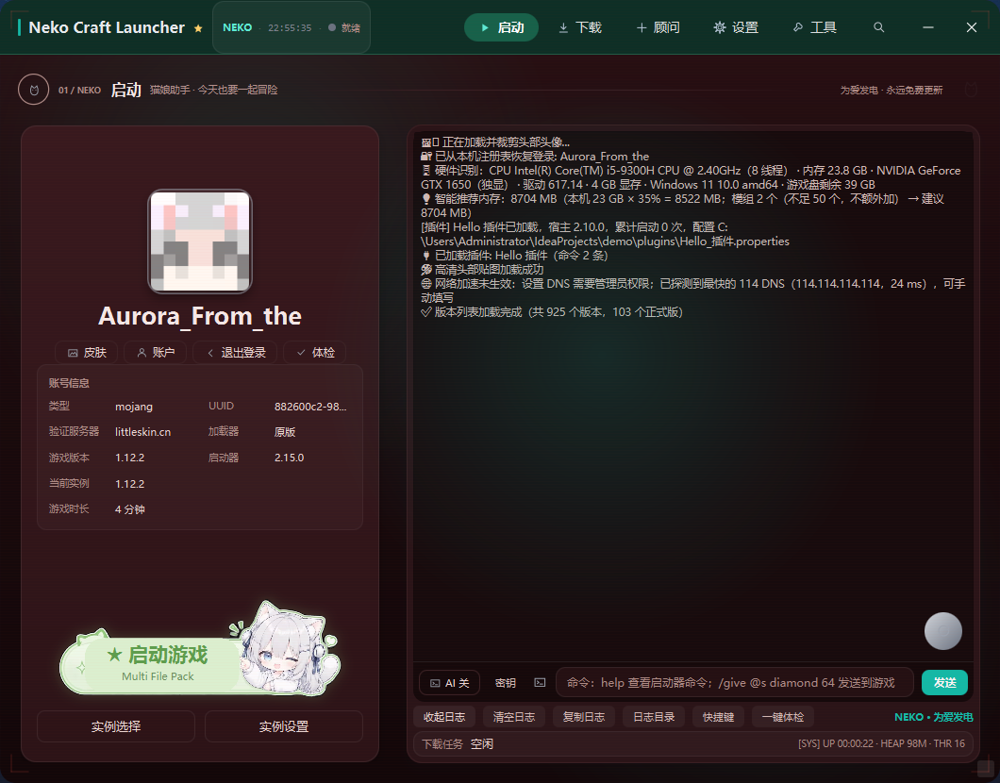

# Neko Craft Launcher 2.16.0

> 这一版先做体检，再动手：完整 CI 跑通（冒烟 / 圆角 / 视觉基线全绿），
> 随后修掉三个真实问题，并把「跟随鼠标的柔光」做成看得见的东西。

## 安装包

| 文件 | 说明 |
|---|---|
| `NekoCraftLauncher-2.16.0.exe` | **安装版**：双击安装，可选目录，开始菜单 + 桌面快捷方式（按用户安装） |
| `NekoCraftLauncher-2.16.0-win64.zip` | 免安装版，解压双击 `NekoCraftLauncher.exe` |
| `NekoCraftLauncher-2.16.0-Features.pdf` / `.docx` | 功能预览（图文版） |
| `SHA256SUMS.txt` / `verify.txt` / `neko-codesign.cer` | 校验与签名材料 |

## 1. 检测结果（先体检再改）

`scripts/ci.ps1 -SkipBuild -Nightly`：

| 步骤 | 结果 |
|---|---|
| 架构守卫 | PASS |
| 文案基线 | PASS |
| 冒烟（5 页 × 悬停 2542 × 体检弹窗 × 安装页面板 × 剪贴板） | PASS |
| 圆角自检 | PASS（4/4 圆角） |
| 视觉基线 | PASS（差异 1.14% < 2%） |

## 2. 修掉的三个问题

| 问题 | 现象 | 处理 |
|---|---|---|
| 安装进度环在浅色主题下看不见 | 环心数字用 `#e5fbf6`（近白），浅色卡片上等于隐形 | 改成主题感知：浅色 `#0f766e` / 深色 `#e5fbf6`，轨道与弧线同步换色 |
| 拖拽提示层残留缩放 | 中途离开窗口时只停了呼吸动画，没复位 scale，下次拖入从 1.012 起跳 | DRAG_EXITED 里复位 `dropBox` 缩放 |
| 视差做在看不见的层上 | 鼠标从左上移到右下，画面平均差异 **0.01**（等于没动） | 见下节：换到页面之上重新实现 |

## 3. 跟随鼠标的柔光（这次是真的看得见）



原来那层 `AmbientBackground` 画在页面**下面**，而页面背景不透明 —— 光晕一直被盖住，
把参数调多大都没用。现在新增 `MouseSheen`，叠在**页面之上、弹窗之下**：

- 径向高光跟随指针缓动（0.18 系数），浅色 alpha 0.14、深色 0.18；
- 指针在动时 20fps，静止 900ms 后降到 2fps，渐变只在主题色变化时重建；
- 验证：13015 个采样点，鼠标位移后平均差异 **6.13**、峰值 **54**（旧层是 0.01）。

## 工程质量

- 编译 0 告警；单元测试 **308 项全绿**
- 完整 CI 全绿（见上表）
- 新增类 `MouseSheen`，无新依赖；动效仍受 `config.animations` 总开关控制

## 校验

```
a91cb5b933b5c51ff822d3f6d88118c3579b25a120c59cc7d7e2fe5ecfb49fac  NekoCraftLauncher-2.16.0.exe
2d8d30d2915cb0c1bb327ff196571d17fef619a95ea3336349e1423df25f88b6  NekoCraftLauncher-2.16.0-win64.zip
b8df51f683e1c65f28d9211fa9e64589bfcc66f4c73f6f3cc9e88c06dc3e44c7  NekoCraftLauncher-2.16.0-Features.pdf
074fee8f84951478a5c8810ca41e973525d7f161b7636fe64dc22431dd676a7d  NekoCraftLauncher-2.16.0-Features.docx
41bdc7658bd42ee52d59d81ccd541597b7deac9e600715ab23327227a73cdb89  neko-codesign.cer
f3d4ac92c3f2a4fe20b5b6adb4b9b0dfcc4db2dfffe4845d709d17c0a9891b17  verify.txt
```
