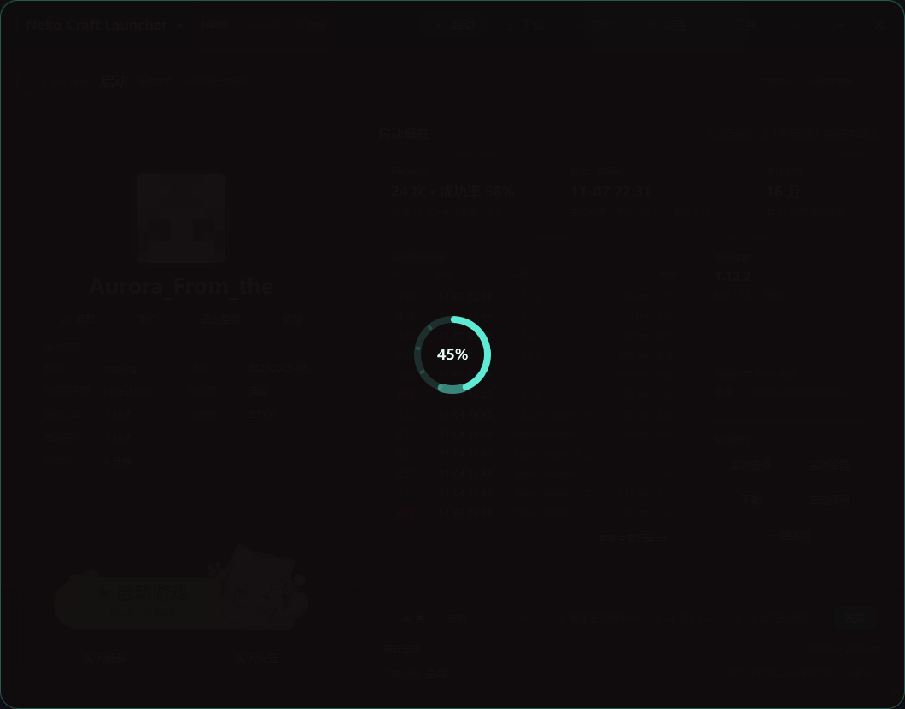

# Neko Craft Launcher 2.18.0

> 三件视觉细活：柔光改成带色相偏移的渐变、卡片换成玻璃质感、安装进度环按 9 个阶段分段。

## 安装包

| 文件 | 说明 |
|---|---|
| `NekoCraftLauncher-2.18.0.exe` | **安装版**：双击安装，可选目录，开始菜单 + 桌面快捷方式（按用户安装） |
| `NekoCraftLauncher-2.18.0-win64.zip` | 免安装版，解压双击 `NekoCraftLauncher.exe` |
| `NekoCraftLauncher-2.18.0-Features.pdf` / `.docx` | 功能预览（图文版） |
| `SHA256SUMS.txt` / `verify.txt` / `neko-codesign.cer` | 校验与签名材料 |

## 1. 柔光加色相偏移

原来是一圈单色径向光，边缘和中心一个颜色，看着平。现在内圈用主题强调色、
外圈用 `deriveColor(+38°)` 的色相偏移，形成「内亮外暖」的渐变；深浅主题各自算 alpha。

## 2. 玻璃卡片

`.neko-card` / `.settings-card` 从「纯色渐变」换成玻璃质感：

- 半透明底（深色 `rgba(64,30,36,0.88)` → `rgba(40,19,23,0.84)`）；
- 顶部 16% 高度的一道白色高光（`rgba(255,255,255,0.07)` → 透明），像玻璃边缘的反光；
- 描边改成内亮外暗双层（`-app-glass-border` + `-app-border-soft`），阴影加深到 20/0.12；
- 两个主题各有一组 `-app-glass-*` 变量，主题切换自动生效。

## 3. 安装进度环：9 段刻度



- `RingProgress.setSegments(9)` / `setStage(i)`：每段留 5° 间隙；
  已完成段实色、进行中段半亮加粗、未开始段暗色；
- 分段几何抽到 [`core.app.RingSegments`](../src/main/java/com/example/demo/core/app/RingSegments.java)
  （槽角 / 弧长 / 起始角 / 进度落段），纯函数，配 5 项单测；
- `-Dmc.ringDemo=1` 启动 2.4 秒后居中展示 45% / 第 5 阶段的环，方便回归与截图。

## 工程质量

- 编译 0 告警；单元测试 **313 项全绿**（+5：环形分段几何）
- 中途一次操作失误删掉了 `HelloApplication` 的一部分（正则替换跨度太大），
  用 `git checkout` 还原后按单点重做，没有残留在发布里
- 文案基线仍为 2175，没有新增裸中文

## 校验

```
e88ac9295eb306162c56f11423738d152132a77ab945ebb65dd6202f50932841  NekoCraftLauncher-2.18.0.exe
cd588f7d1a3b7c7ca77a36a14ba9b521fa93253752ff03f8ba90c1441e218e8a  NekoCraftLauncher-2.18.0-win64.zip
b08952b084a98f74c51fa5a6044c01945b8de7f94adbdaacbedc79ed0b7597b2  NekoCraftLauncher-2.18.0-Features.pdf
ce48ddf0fd34179cb4b86f129fe2f6ea864a4376fee41becbf12b2f43a434199  NekoCraftLauncher-2.18.0-Features.docx
41bdc7658bd42ee52d59d81ccd541597b7deac9e600715ab23327227a73cdb89  neko-codesign.cer
8aaf58894189f4ac42638a03f04613a94e05e2f7649e35ffd9ba7156167a8d05  verify.txt
```
