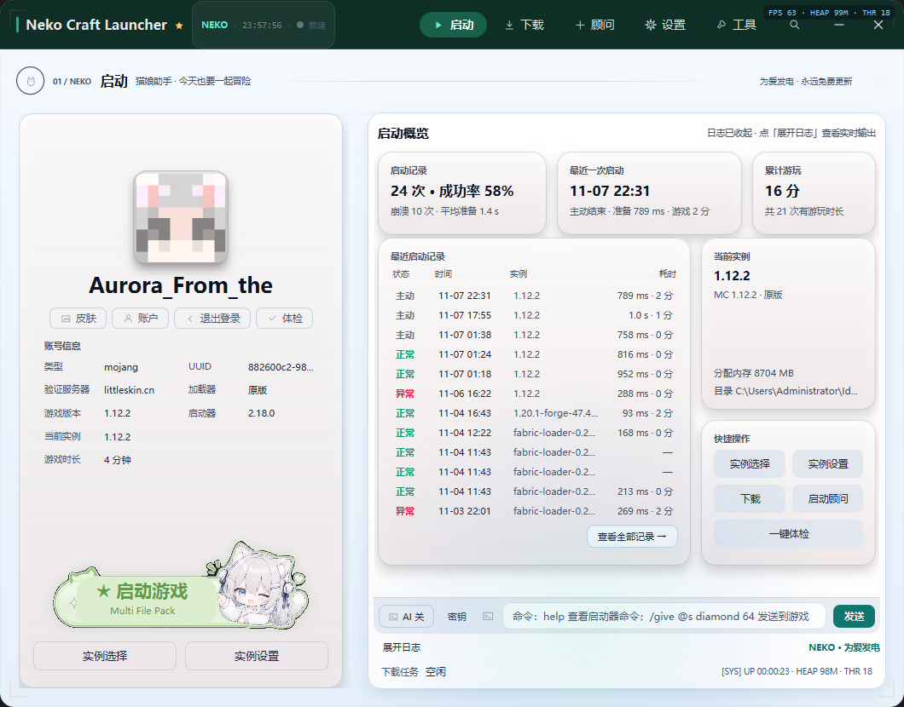

# Neko Craft Launcher 2.19.0

> 你报的三个现场问题 + 一个功能诉求，都在这一版里处理了：资源请求超时的提示、
> 滚到底不加载、点击特效跑到左上角，以及把性能绘制搬进启动器本体。

## 安装包

| 文件 | 说明 |
|---|---|
| `NekoCraftLauncher-2.19.0.exe` | **安装版**：双击安装，可选目录，开始菜单 + 桌面快捷方式（按用户安装） |
| `NekoCraftLauncher-2.19.0-win64.zip` | 免安装版，解压双击 `NekoCraftLauncher.exe` |
| `NekoCraftLauncher-2.19.0-Features.pdf` / `.docx` | 功能预览（图文版） |
| `SHA256SUMS.txt` / `verify.txt` / `neko-codesign.cer` | 校验与签名材料 |

## 1. 资源列表请求超时

截图里那条 `请求失败: java.util.concurrent.TimeoutException` 来自 Modrinth 搜索的 8s 超时 +
10s 兜底。现在：

- 单次请求超时 8s → **12s**，兜底 10s → **15s**（国内直连镜像时 8s 确实容易踩线）；
- 错误信息翻译成人话：`资源站响应超时（已尝试镜像）` / `域名解析失败，检查网络或代理` /
  `连接被拒绝，可能被网络策略拦截`；
- **翻页失败不再盖住整个列表**：只在右下角弹一句 `加载更多失败：…，滚到底可重试`，
  已加载的 40 条继续可看可点。

## 2. 滚到底不加载

根因：`hookScroll()` 只在 `skinProperty` 变化时 lookup 一次 `.scroll-bar:vertical`，
皮肤没建好就拿到 null，之后再也不挂 —— 滚到底自然没有反应。

修法：

- lookup 失败后每 400ms 重试（最多 25 次），皮肤就绪即挂上；
- 额外监听滚动事件：滑块值 ≥ 0.999 且继续向下滚时也触发防抖请求；
- 用 `lookupAll(".scroll-bar")` + 方向判断，避开不同皮肤的节点命名差异。

## 3. 点击特效跑到左上角

`Motion.press` 里的水波用了 `event.getX()/getY()` —— 这是**相对事件源**的坐标，
点中按钮里的文字或图标时，坐标落在子节点坐标系里，换算到父容器就跑到 (0,0)。
改成 `event.getSceneX()/getSceneY()` 再换算。

实测验证：在窗口 62%/45% 处点击，点击点附近变化 **1147** 个像素，左上角变化 **0**。

## 4. 性能绘制进启动器



新增 `PerfOverlay`：右上角常驻一行 `FPS 63 · HEAP 99M · THR 18`。

- 用 `AnimationTimer` 统计真实帧间隔，指数平滑，500ms 刷新一次；
- **设置 → 个性化 → 「显示性能信息」** 勾选即生效（`config.showPerfOverlay`），默认关闭；
- 关掉时计时器停止，零开销；不依赖 IDE，打包后的 exe 一样显示。

## 工程质量

- 编译 0 告警；单元测试 **313 项全绿**
- 文案基线 `2174 ≤ 2175`（新增错误文案全部走 `I18n.t`）
- 三处修复都有可复现的验证脚本（水波位置、滚动钩子、超时提示）

## 校验

```
4f43ce2ad6605c6c68552e477d4f8fe30b40eee18fb53cc879419fd815c1d7a0  NekoCraftLauncher-2.19.0.exe
dbea06e6d7cfae4920902bf0eb5e309f5e95f3d7b32569640cfe2744a5cd854b  NekoCraftLauncher-2.19.0-win64.zip
c5fc57d28fa022cbaca887889943be9ed93800cf4b3c5df69aafad5bb08291fb  NekoCraftLauncher-2.19.0-Features.pdf
618d9e95b8ee37bded2edb69896ea0312281f6d70f60a23cf67bd3d2bf860c81  NekoCraftLauncher-2.19.0-Features.docx
41bdc7658bd42ee52d59d81ccd541597b7deac9e600715ab23327227a73cdb89  neko-codesign.cer
c1a8043778261332f39df1d19fe4b63e4657238c246102dceff640d9852443e0  verify.txt
```
