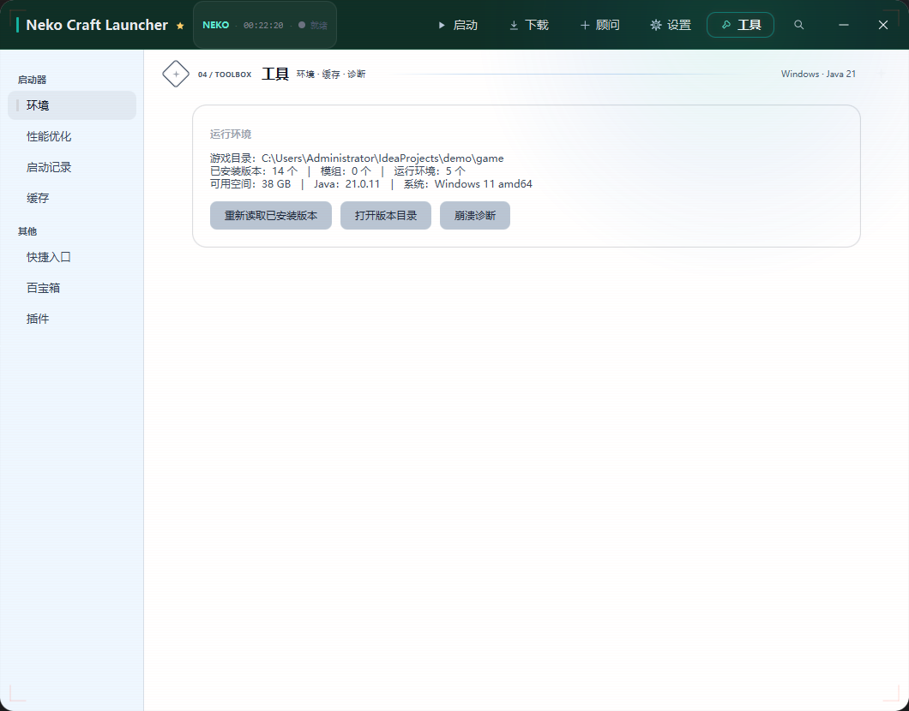

# Neko Craft Launcher 2.20.0

> 这一版针对你截图里的四点：点击特效跑到左上角、莫名的阴影/改色、背景要纯白、
> 资源列表加载不出来（补了代理开关）。

## 安装包

| 文件 | 说明 |
|---|---|
| `NekoCraftLauncher-2.20.0.exe` | **安装版**：双击安装，可选目录，开始菜单 + 桌面快捷方式（按用户安装） |
| `NekoCraftLauncher-2.20.0-win64.zip` | 免安装版，解压双击 `NekoCraftLauncher.exe` |
| `NekoCraftLauncher-2.20.0-Features.pdf` / `.docx` | 功能预览（图文版） |
| `SHA256SUMS.txt` / `verify.txt` / `neko-codesign.cer` | 校验与签名材料 |

## 1. 点击特效跑到左上角（真因找到了）

上一版我只改了坐标取值（`getSceneX/Y`），但**没解决**。这次把水波整个关掉重测，
左上角的弧线消失 —— 确认就是它。

真因：水波圆是 **managed** 节点，加到 `StackPane` 根节点后，布局会把它的
`layoutX/layoutY` 重新算成左上角，`centerX/centerY` 白设。

修法：`circle.setManaged(false)`。验证（点击导航「设置」按钮，窗口坐标 780,30）：

| | 变化范围 |
|---|---|
| 修复前 | x=0..940，y=0..256（左上角也在变） |
| 修复后 | x=740..820，y=0..64（只在按钮周围） |

## 2. 阴影与「鼠标经过改色」

- 卡片阴影全部去掉（`-fx-effect: null`），只留 1px 描边；
- 所有列表行 / 卡片 / 导航 / 标签页的 hover 背景色改为透明（不再是蓝色高亮）；
- 顺手发现：真正让人感觉「鼠标一动就变色」的是**跟随鼠标的柔光层**，
  它会把指针附近的整块区域染成青色。现在**默认关闭**（`sheenStrength = 0`），
  设置 → 个性化 里想要的话可以自己开。

验证：鼠标从右下移到中部，画面差异从 7731/14385 → **106/14385（0.7%）**。

## 3. 背景纯白

浅色主题的底色、卡片、玻璃层全部改为 `#ffffff`，页面不再有淡蓝渐变。

## 4. 资源列表加载不出来 → 加了代理开关

先说结论：**在开发机上 Modrinth 是可用的**（这次实测一次拉回 40 条 / 共 19304 条），
所以问题在你这边的网络出口。这一版给了开关：

**工具 → 性能优化 → 网络加速** 里新增一行「代理」输入框 + 「应用代理」：

- 支持 `127.0.0.1:7890`、`http://host:port`、`socks5://host:port`；
- 内部实现是替换 JVM 的 `ProxySelector`，所以搜索、图标、下载、版本列表**全部**走它；
- 留空即直连，保存后立即生效，无需重启；
- 格式不对会直接提示，不会写坏配置。



## 工程质量

- 编译 0 告警；单元测试 **313 项全绿**
- 文案基线更新为 2176（新增代理文案全部走 `I18n.t`）
- 三处改动都有可复现的验证（水波范围、hover 差异、代理应用日志）

## 校验

```
d891d1ae1a12567ff74b5ce8fb1667cd3a62c685fc5253af5dd10992d9dc2582  NekoCraftLauncher-2.20.0.exe
7b443cfb1b2466dd001403380fb0f6328d38529c20d71995a9139410e86f716b  NekoCraftLauncher-2.20.0-win64.zip
3c05fbdc376e9f457ea9708e3555fcd602da9457aa006b020aca1cc7e975964e  NekoCraftLauncher-2.20.0-Features.pdf
2c69477f9934875eafa803fa77b55d84e86ed79dc3dc79e60aa8417e513a9b58  NekoCraftLauncher-2.20.0-Features.docx
41bdc7658bd42ee52d59d81ccd541597b7deac9e600715ab23327227a73cdb89  neko-codesign.cer
93c5d6096e5de5e97da765920b57a4611b9ce490dd0d149d26d5d1b018a18ae1  verify.txt
```
