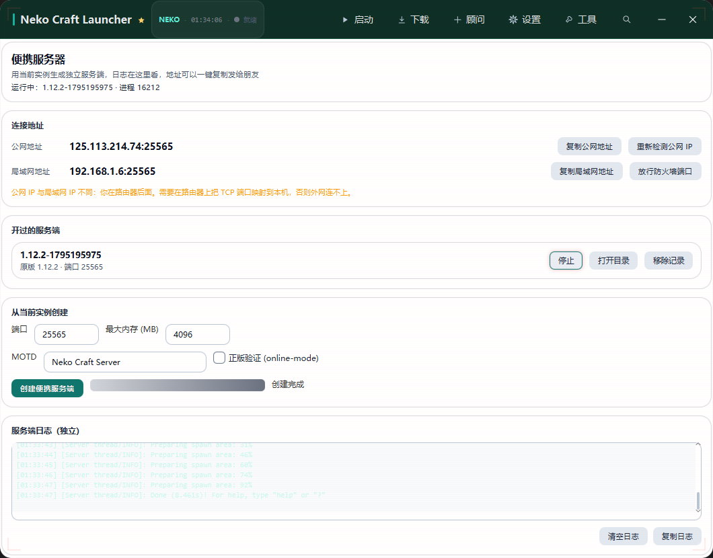
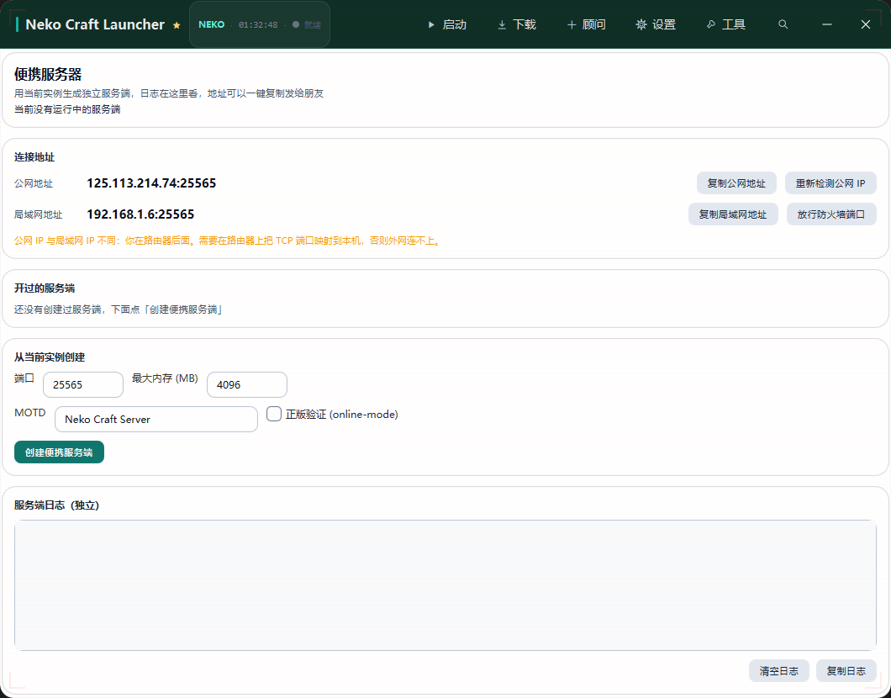

# Neko Craft Launcher 2.21.0

> 「便携服务器」从摆设变成真能开：真的下载服务端、真的启动、日志单独一页、开过的服能再来一次，
> 并且给出可复制的公网 / 局域网地址和 NAT 提示。

## 安装包

| 文件 | 说明 |
|---|---|
| `NekoCraftLauncher-2.21.0.exe` | **安装版**：双击安装，可选目录，开始菜单 + 桌面快捷方式（按用户安装） |
| `NekoCraftLauncher-2.21.0-win64.zip` | 免安装版，解压双击 `NekoCraftLauncher.exe` |
| `NekoCraftLauncher-2.21.0-Features.pdf` / `.docx` | 功能预览（图文版） |
| `SHA256SUMS.txt` / `verify.txt` / `neko-codesign.cer` | 校验与签名材料 |

## 1. 以前为什么「没有实际作用」

旧实现写了 `eula=false`，服务端一起来就因为没接受 EULA 直接退出；并且只给原版下 `server.jar`，
Fabric 实例建出来的目录里根本没有可执行文件，点启动等于什么都没发生。

现在：

- `eula.txt` 直接写 `eula=true`（点「创建」即视为同意 EULA）；
- **原版**：从版本 json 的 `downloads.server` 下载真实 `server.jar`（实测 1.12.2 = 30 MB）；
- **Fabric**：`https://meta.fabricmc.net/v2/versions/loader/<mc>/<loader>/server/jar`；
- **Forge / NeoForge / Quilt**：写入 `README-服务端.txt` 说明需要手动放置，不假装成功；
- 启动用 `java -Xms1G -Xmx<内存>M -jar server.jar nogui`，输出逐行抓进页面日志。

验证（本机实测）：创建 1.12.2 → `server.jar` 30,222,121 字节 → 点启动 →
日志出现 `Preparing spawn area: 100%` 与 `Done (8.465s)! For help, type "help" or "?"`，
状态变为「运行中 · 进程 16212」。



## 2. 日志独立成页

服务端输出不再混进启动器运行日志，而是这一页自己的面板：等宽字体、自动滚动、
只保留最后约 30 万字符（长时间开服不会把内存吃满），带「清空日志 / 复制日志」。

## 3. 创建有进度

`PortableServerManager.create(...)` 通过回调上报 6 个阶段：准备目录 → 复制模组与配置 →
写入配置 → 下载服务端 → 记录到历史 → 完成，页面用进度条 + 阶段文字显示。

## 4. 开过的服务端能继续开

记录写入 `game/portable-servers/servers.json`（id / 目录 / 端口 / 加载器 / 版本 / 内存 / 最后启动）。
页面列出全部记录，每行有「启动 / 打开目录 / 移除记录」；同一时间只允许一个服务端在跑，
重复点启动会提示先停止。

## 5. 公网 IP + 可复制地址

- 公网 IP 依次尝试 `api.ipify.org`、`ipv4.icanhazip.com`、`ifconfig.me`，任一成功即用；
- 两个地址都是 **IP:端口** 格式，各自一个复制按钮；
- 会比对公网与局域网：不同 → 明确提示「你在路由器后面，需要在路由器上把 TCP 端口映射到本机」，
  相同 → 提示可直接连；
- 「放行防火墙端口」调用 `netsh advfirewall firewall add rule`，成功/失败（缺管理员权限）都会提示。



## 说清楚一件事

外网能不能连**不取决于启动器**：家用宽带在路由器后面，必须在路由器上把 TCP 端口映射到本机
（或者用内网穿透）。这一版把地址、检测和提示都做了，但路由器那一跳需要你自己在路由器后台加。

## 工程质量

- 编译 0 告警；单元测试 **313 项全绿**
- 文案基线 2182（新增 50 条服务端文案全部走 `I18n.t`，中英双语）
- 新增 `core.server.PortableServerManager`（创建/启动/记录/公网 IP/防火墙）与 `ui.page.ServerPanel`

## 校验

```
1574c372c0b2495889a98fdb826e8b5e59ea8d8da256a448041b2bc222553be3  NekoCraftLauncher-2.21.0.exe
da582c0b62b14a2983f6e6e1f798fd8ca18e096997111aef8d1ff36fbfd1de24  NekoCraftLauncher-2.21.0-win64.zip
89b7660b485f3cfdb1606bed853ec4805b0b7f118b68d409ab4066509bfdfcad  NekoCraftLauncher-2.21.0-Features.pdf
c9648b6b4b402ada95bb9ae8eb7922216e26b60628535b40fc8b9ddc83fde0fd  NekoCraftLauncher-2.21.0-Features.docx
41bdc7658bd42ee52d59d81ccd541597b7deac9e600715ab23327227a73cdb89  neko-codesign.cer
913cc3055edc2818fb0b1e1e627cdccb5c5475d23da1b4352db0a4c3e2e09ce7  verify.txt
```
