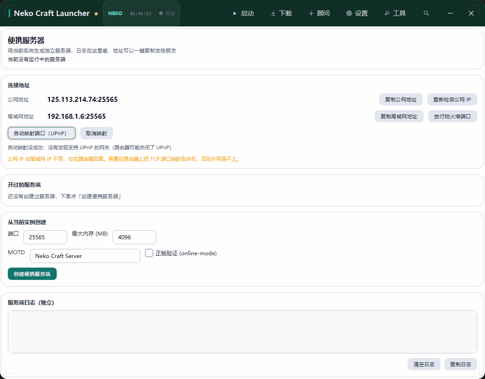

# Neko Craft Launcher 2.22.0

> 上一版把服务器做真了，这一版补上「外网怎么连」：一键 UPnP 自动端口映射，
> 失败也会告诉你具体卡在哪一步，而不是笼统地说不行。

## 安装包

| 文件 | 说明 |
|---|---|
| `NekoCraftLauncher-2.22.0.exe` | **安装版**：双击安装，可选目录，开始菜单 + 桌面快捷方式（按用户安装） |
| `NekoCraftLauncher-2.22.0-win64.zip` | 免安装版，解压双击 `NekoCraftLauncher.exe` |
| `NekoCraftLauncher-2.22.0-Features.pdf` / `.docx` | 功能预览（图文版） |
| `SHA256SUMS.txt` / `verify.txt` / `neko-codesign.cer` | 校验与签名材料 |

## 一键 UPnP 端口映射

服务器页新增「自动映射端口（UPnP）」和「取消映射」：

1. **SSDP 发现**：组播 `239.255.255.250:1900` 发 M-SEARCH；
2. **单播兜底**：很多固件不理组播，会再从 `ipconfig` 里读默认网关，单独发一次单播；
3. **解析设备描述**：拉 `LOCATION` 的 XML，找 `WANIPConnection`（找不到再退 `WANPPPConnection`）服务的 `controlURL`；
4. **SOAP AddPortMapping**：把 `TCP <端口>` 映射到本机局域网 IP，租期 0（永久，可随时删）；
5. 成功后调 `GetExternalIPAddress`，把页面上的公网地址换成**网关自己报的**公网 IP，比第三方回显更可信。

全程只用 JDK，不引第三方库。映射走的是独立 `HttpClient` 并强制 `NO_PROXY` ——
否则你在设置里配的代理会把发往 `192.168.x.x` 的请求也劫走。



## 失败也说实话

这台开发机的网络上没有 UPnP 网关（组播和单播都没响应），页面就如实显示：

> 自动映射没成功：没有发现支持 UPnP 的网关（路由器可能关闭了 UPnP）

然后仍然把 NAT 提示摆在那儿，告诉你去路由器做端口映射。**不假装成功**。

## 测试

新增 4 项单测覆盖最容易出错的纯逻辑：

- SSDP 响应里大小写混排也能取到 `LOCATION`；
- 缺头 / 传 null 时返回 null 而不是抛异常；
- SOAP 信封把 action 名与参数包在正确的命名空间里；
- `behindNat` 只在拿到公网 IP 且与局域网不同时才判定在 NAT 后。

## 工程质量

- 编译 0 告警；单元测试 **317 项全绿**（+4）
- 文案基线 2182（新增 6 条 UPnP 文案，中英双语）
- 新增 `core.server.UpnpPortMapper`，页面接线在 `ServerPanel`

## 校验

```
561874a7a744c61739527be08ed9da277e7c5e9ce27df07f1027ae21c5919691  NekoCraftLauncher-2.22.0.exe
8188427579a33f77ba3c27989de95c418d5f6ffc73fc8578e71e2df54d61b5e9  NekoCraftLauncher-2.22.0-win64.zip
bd1b98908f640f9945879c152c722baa2f42b2ca5106cc77bc4fcd75b24da9c1  NekoCraftLauncher-2.22.0-Features.pdf
133b14dd585a11f20ad3252a36167deedb384178cedcbc4386b3abd6a486b4f2  NekoCraftLauncher-2.22.0-Features.docx
41bdc7658bd42ee52d59d81ccd541597b7deac9e600715ab23327227a73cdb89  neko-codesign.cer
9666551c9a9c5fa251656185dec8e9708747ca287e4fce21ac12fa88288b5b15  verify.txt
```
