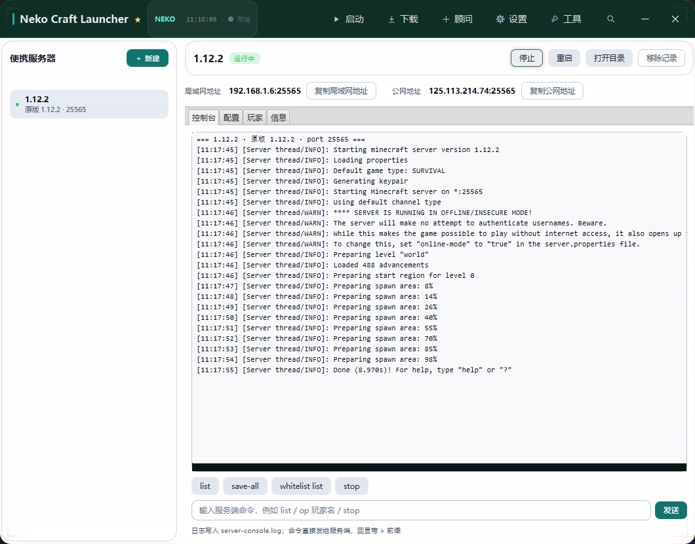
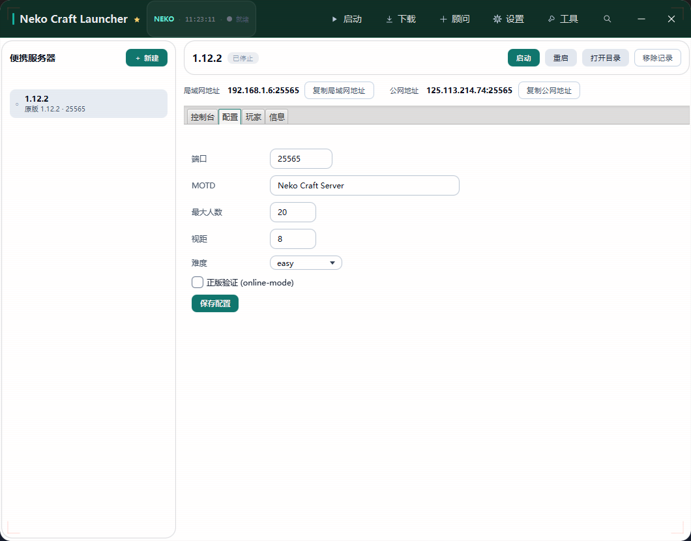

# Neko Craft Launcher 2.24.0

> 服务器页按主流面板的结构重做：左边选服、右边看板，控制台 / 配置 / 玩家 / 信息四个标签页，
> 终端配色、快捷命令、启停重启都在一屏里。

## 安装包

| 文件 | 说明 |
|---|---|
| `NekoCraftLauncher-2.24.0.exe` | **安装版**：双击安装，可选目录，开始菜单 + 桌面快捷方式（按用户安装） |
| `NekoCraftLauncher-2.24.0-win64.zip` | 免安装版，解压双击 `NekoCraftLauncher.exe` |
| `NekoCraftLauncher-2.24.0-Features.pdf` / `.docx` | 功能预览（图文版） |
| `SHA256SUMS.txt` / `verify.txt` / `neko-codesign.cer` | 校验与签名材料 |

## 布局：左列表 + 右看板



- **左栏**：服务端列表，运行中的带绿点，点击切换；右上角「＋ 新建」直接开创建表单（带进度条）；
- **右栏顶部**：名称 + `运行中 / 已停止` 状态药丸 + `启动/停止 · 重启 · 打开目录 · 移除记录`；
- **地址条**：局域网与公网 `IP:端口` 各一个复制按钮。

## 四个标签页

| 标签 | 内容 |
|---|---|
| **控制台** | 深色终端 + `list / save-all / whitelist list / stop` 快捷按钮 + 命令输入框；切服时自动载入 `server-console.log` 尾部 200 行 |
| **配置** | `server.properties` 常用项表单（端口 / MOTD / 最大人数 / 视距 / 难度 / 正版验证），保存时只改这些键，其余原样保留 |
| **玩家** | 读 `ops.json` / `whitelist.json` / `banned-players.json`，可一键「加为 OP / 加入白名单」写回 |
| **信息** | 加载器、版本、端口、内存、目录、最后启动；外网区：UPnP 映射 / 取消 / 可达性检测 / 防火墙放行 |



## 这轮修掉的三个细节

1. **终端底色被主题覆盖**：`-fx-control-inner-background` 只作用在 TextArea 自己身上，
   内层 `.content` 还是主题的浅色 —— 选择器加上 `.text-area` 提高优先级后才真正变黑；
2. **难度显示成 `1`**：1.12 的 `server.properties` 里 `difficulty` 是数字，ComboBox 里只有名字。
   现在显示映射成 `peaceful/easy/normal/hard`，写回时还原数字，文件格式不变；
3. **「最大人数」用了「最大内存」的文案键**，已拆成独立键 `server.panel.maxPlayers`。

## 实测

- 新建 1.12.2 服 → 控制台出现 `Done (8.978s)!`，状态药丸变「运行中」，按钮切换成「停止」；
- 配置页改完点保存：`server.properties` 被重写但 **所有已有键都保留**，`difficulty` 仍是数字 `1`；
- 重启、打开目录、复制地址、切服载入历史日志均按预期工作。

## 工程质量

- 编译 0 告警；单元测试 **317 项全绿**；文案基线 2179
- 新增 `core.server.ServerFiles`（properties 读写 + 玩家名单），无新依赖

## 校验

```
7270119f973d2cec235b26924a4550e29e4ce99b136de171e56c3506470b4155  NekoCraftLauncher-2.24.0.exe
81d29bf37e6324768174dfa64d9d1ee2baa89df355e655b2b6437a0feb31b6c2  NekoCraftLauncher-2.24.0-win64.zip
85c91ca3342513636c8b45371abefc7be393b9733a1610d050c89c4c8cb716c4  NekoCraftLauncher-2.24.0-Features.pdf
df3336f9c818c6f54d0242a1b4afa6e131a0030e001422bd12967f599b170208  NekoCraftLauncher-2.24.0-Features.docx
41bdc7658bd42ee52d59d81ccd541597b7deac9e600715ab23327227a73cdb89  neko-codesign.cer
45b0175cfdfe58cd6ba72049b6988c5b825e9e241419b7b08cab38557a307caf  verify.txt
```
