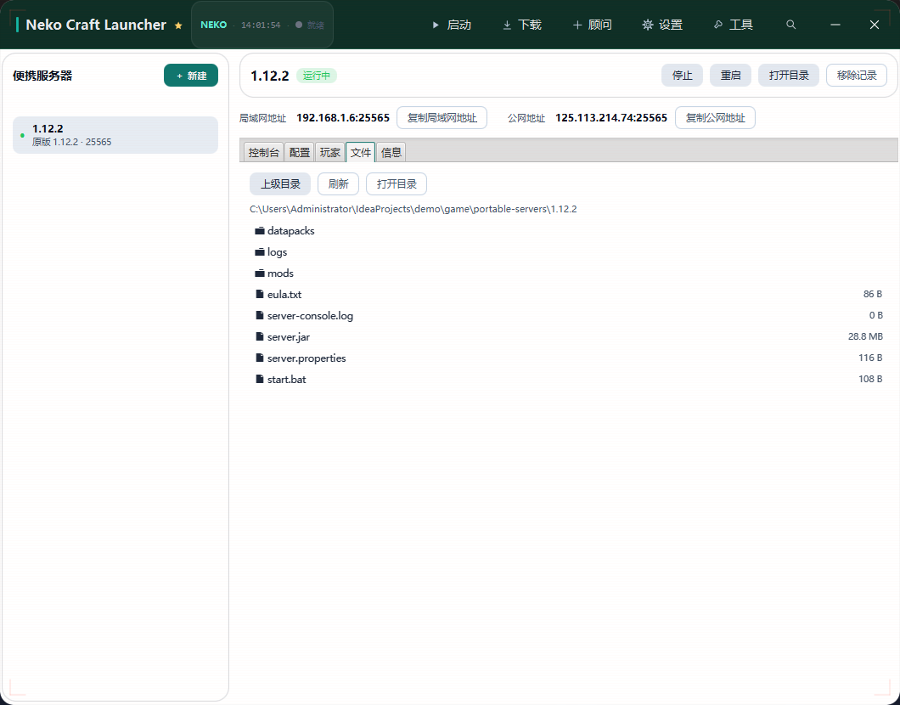
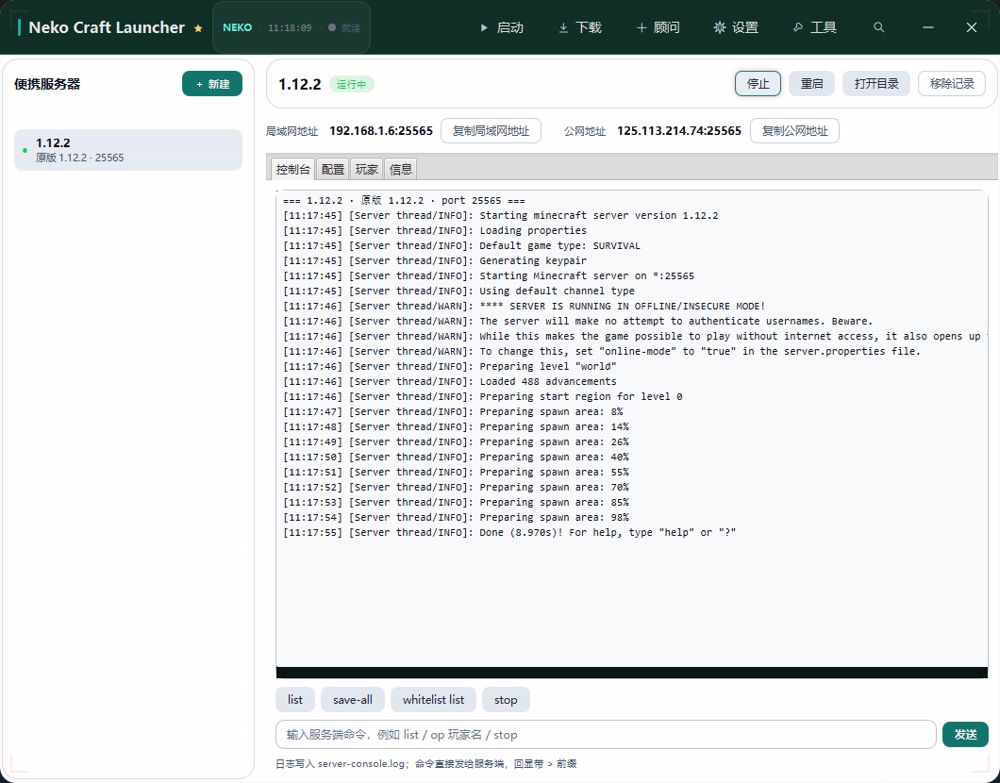
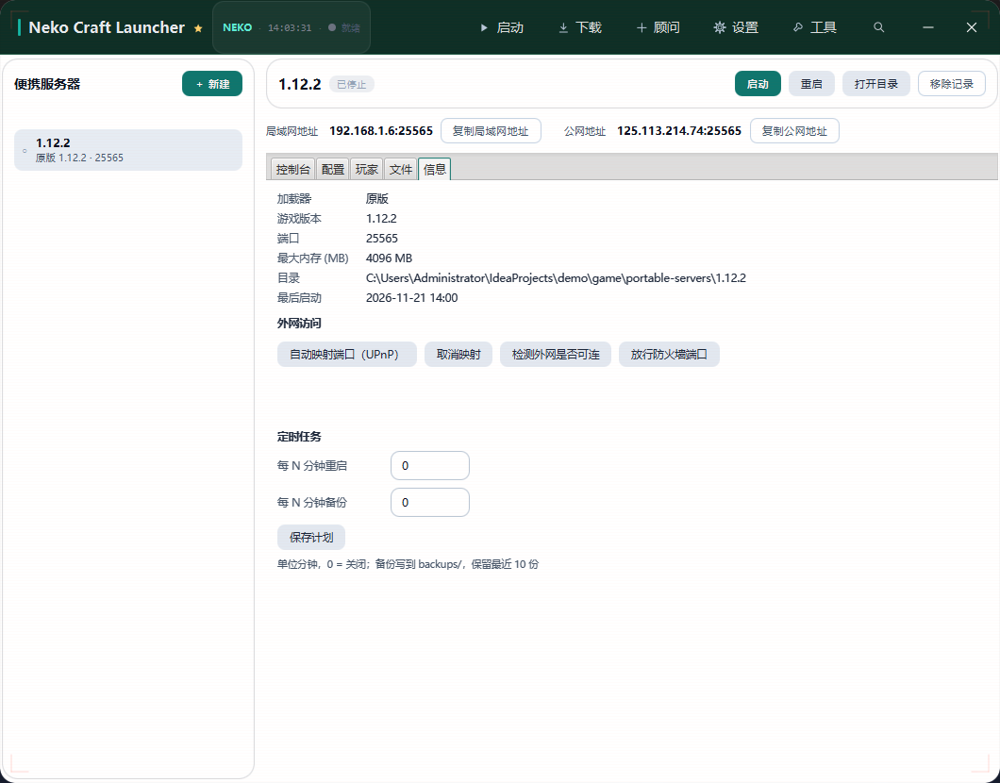

# Neko Craft Launcher 2.25.0

> 服务器面板补上最后三块：文件管理、资源曲线、定时任务。附安装包。

## 安装包

| 文件 | 说明 |
|---|---|
| `NekoCraftLauncher-2.25.0.exe` | **安装版**：双击安装，可选目录，开始菜单 + 桌面快捷方式（按用户安装） |
| `NekoCraftLauncher-2.25.0-win64.zip` | 免安装版，解压双击 `NekoCraftLauncher.exe` |
| `NekoCraftLauncher-2.25.0-Features.pdf` / `.docx` | 功能预览（图文版） |
| `SHA256SUMS.txt` / `verify.txt` / `neko-codesign.cer` | 校验与签名材料 |

## 1. 文件标签页



- 列出服务端目录（目录在前、按名称排序，带大小）；
- 点目录进入，`上级目录` 回退（不会越出服务端根目录）；
- 点 ≤512 KB 的文本文件直接在面板里打开编辑，`保存文件` 写回；
- 更大的文件交给系统默认程序打开。

## 2. 资源曲线

控制台顶部一条 280×58 的迷你折线：**青线 = CPU%**、**橙线 = 内存 MB**。

- CPU：`ProcessHandle.info().totalCpuDuration()` 的累计时间差分，2 秒一次；
- 内存：`tasklist` 的 Mem Usage（约 20ms，可接受，不引第三方库）；
- 保留最近 60 个采样点；服务端停止时自动停表，空闲不耗 CPU。



## 3. 定时任务



- 每个服独立配置，写在 `neko-schedule.json`：`每 N 分钟重启` / `每 N 分钟备份`，`0 = 关闭`；
- 备份把 `world/` 打成 `backups/world-<时间>.zip`，只保留最近 10 份；
- 调度器 30 秒检查一次，重启走「优雅 stop → 退出后重启」，不会硬杀进程。

## 实测

- 面板里建服 → 启动 → 曲线出现 `CPU 0% MEM 809 MB`（空载），日志照常滚动；
- 文件页看到 `server.jar 28.8 MB`、`server.properties 116 B`、`mods/`、`logs/` 等；
- 信息页四个动作按钮与定时任务表单就位，`保存计划` 写入 `neko-schedule.json`；
- 单测覆盖：计划读写往返、坏 JSON 兜底、world 打包非空、缺 world 时报可读错误。

## 工程质量

- 编译 0 告警；单元测试 **321 项全绿**（+4）
- 新增 `core.server.ServerMetrics`（CPU 采样 / 内存读取 / 计划读写 / world 备份），无新依赖
- 修掉：📁/📄 emoji 在默认字体下渲染成方块 → 改用 `▸ / ·`；信息页两个小标题因继承色不可见 → 统一 `sectionLabel`

## 校验

```
734f9166a480090f5691809ac69464d2dc40876608cfca037e7ed4f2ee64cf70  NekoCraftLauncher-2.25.0.exe
06c9474124de9890cd6343b1ef97531ec8c087b66d9786556253792a9bf86d0b  NekoCraftLauncher-2.25.0-win64.zip
95303f64b6d4e169c40b888ceea6d252ee7b4d5a41d29e27d1b4d8fc344260e1  NekoCraftLauncher-2.25.0-Features.pdf
e4399ce7e2439e574192d7213b7ebf6becfd56cebe5f3fd11bebb0ec88c07d74  NekoCraftLauncher-2.25.0-Features.docx
41bdc7658bd42ee52d59d81ccd541597b7deac9e600715ab23327227a73cdb89  neko-codesign.cer
2d77160d6c7adf6bb88c2dfb0e6f7f68d0b503d5a52c9b629b152b8ae436d17c  verify.txt
```
