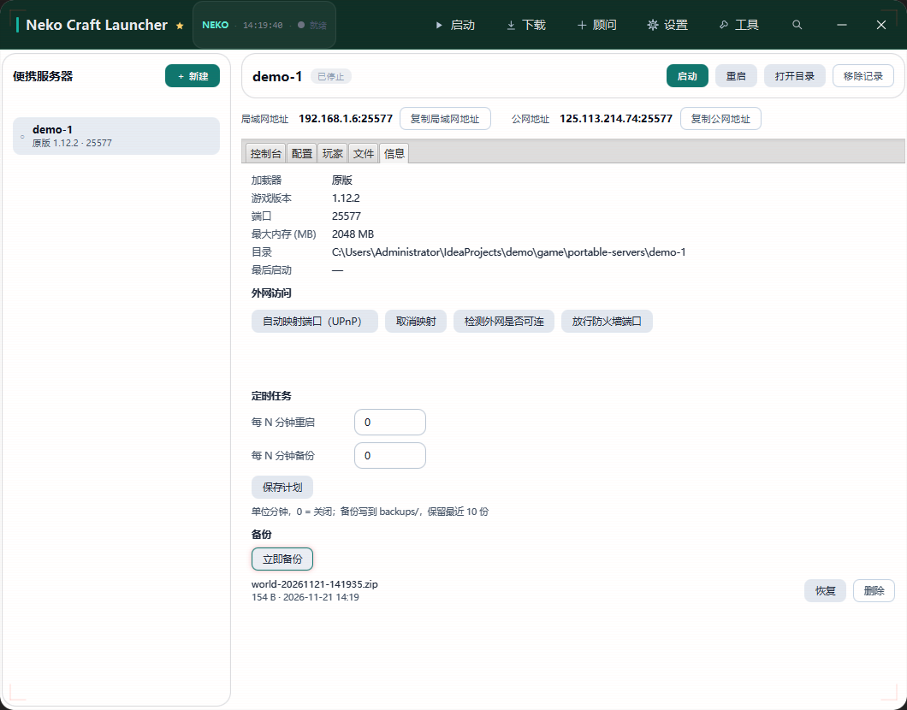

# Neko Craft Launcher 2.26.0

> 接着定时备份往下做：备份能看、能立刻做、能恢复、能删。附安装包。

## 安装包

| 文件 | 说明 |
|---|---|
| `NekoCraftLauncher-2.26.0.exe` | **安装版**：双击安装，可选目录，开始菜单 + 桌面快捷方式（按用户安装） |
| `NekoCraftLauncher-2.26.0-win64.zip` | 免安装版，解压双击 `NekoCraftLauncher.exe` |
| `NekoCraftLauncher-2.26.0-Features.pdf` / `.docx` | 功能预览（图文版） |
| `SHA256SUMS.txt` / `verify.txt` / `neko-codesign.cer` | 校验与签名材料 |

## 备份管理



信息页新增「备份」区：

- **立即备份**：把 `world/` 打成 `backups/world-<时间>.zip`，列表立刻刷新；
- **列表**：文件名 + 大小 + 时间，按最新在前排序；
- **恢复**：先把当前 `world` 改名成 `world.before-restore-<时间>`，再解压备份 ——
  解压失败还能把旧世界挪回来，不是「一删了之」；
- **删除**：删掉单份备份；
- 定时任务自动产生的备份与手动备份走同一条路径，都保留最近 10 份。

实测：点「立即备份」后生成 `world-20261121-141935.zip`（154 B，demo 世界），
列表显示 `154 B · 2026-11-21 14:19`，恢复/删除按钮就位。

## 顺手加的调试开关

`-Dmc.serverPage=1` 启动后 2.6 秒直接进入便携服务器页 ——
每次点「设置 → 联机 → 打开便携服务器页」三层太费劲，截图和回归都用它。

## 工程质量

- 编译 0 告警；单元测试 **324 项全绿**（+3：恢复保留旧世界、列表按时间倒序、缺文件被拒）
- 文案基线 2179；`core.server.ServerMetrics` 扩了 `listBackups` / `restoreBackup`

## 校验

```
794d7a5358ca5a8de075ce9670d8ba9a71cb78ad4de5c9f5e452ff84e317dc38  NekoCraftLauncher-2.26.0.exe
e5ded3047f845911a3551e5887600327afc066a95c11b0f191d3472854306a7e  NekoCraftLauncher-2.26.0-win64.zip
ad1bbb772accb6c2b3517f196e387fae3abc826f951a3189cbe08647d7750577  NekoCraftLauncher-2.26.0-Features.pdf
d85aaaced50858dbdc77bd3931167fef48f44d38a0090d876a6e954cb71f7091  NekoCraftLauncher-2.26.0-Features.docx
41bdc7658bd42ee52d59d81ccd541597b7deac9e600715ab23327227a73cdb89  neko-codesign.cer
e7f17489c94ecbf952e69da386b398d2fbf4089df0eb958176c379943a249d58  verify.txt
```
