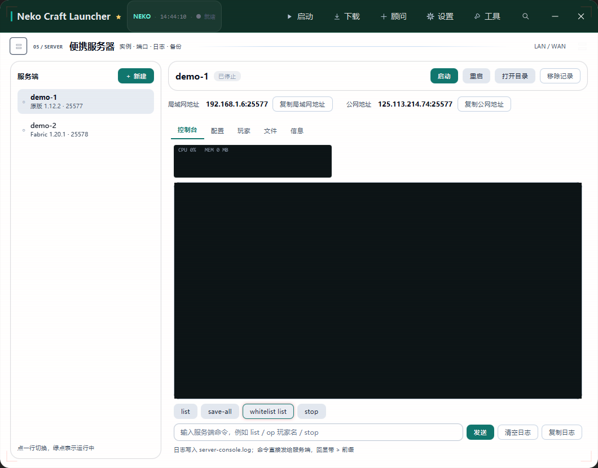

# Neko Craft Launcher 2.27.0

> 服务器页的 UI 补齐与统一：模块头、标签栏、侧栏、按钮、空状态都跟其它页面一套语言。

## 安装包

| 文件 | 说明 |
|---|---|
| `NekoCraftLauncher-2.27.0.exe` | **安装版**：双击安装，可选目录，开始菜单 + 桌面快捷方式（按用户安装） |
| `NekoCraftLauncher-2.27.0-win64.zip` | 免安装版，解压双击 `NekoCraftLauncher.exe` |
| `NekoCraftLauncher-2.27.0-Features.pdf` / `.docx` | 功能预览（图文版） |
| `SHA256SUMS.txt` / `verify.txt` / `neko-codesign.cer` | 校验与签名材料 |

## 统一到同一套视觉



| 项 | 之前 | 现在 |
|---|---|---|
| 页面头部 | 自己写的一行标题 | 复用 `ModuleHeader`：`05 / SERVER` + 图形徽标 + 标题 + 副标题 + 右侧 `LAN / WAN` 水印 |
| 标签栏 | 默认 TabPane 灰底 | `.server-tabs`：透明底、小字号、选中项强调色下划线 |
| 侧栏 | 只有列表 | 列表 + 底部说明「点一行切换，绿点表示运行中」，与实例页的操作提示一致 |
| 内边距 | 4/2/4/2 | 8/18/16/18，与下载页等内容区对齐 |
| 小标题 | 部分裸 Label | 全部走 `sectionLabel`（配置页的 `server.properties（常用项）` 也已统一） |
| 按钮 | 混用 | 主动作 `btn-primary btn-sm`、次动作 `btn-secondary btn-sm`、轻动作 `btn-ghost btn-sm` |

## 补全的功能

- **控制台**：补回「清空日志 / 复制日志」，输入行现在四个控件对齐；
- **玩家**：每条 OP / 白名单都有「移除」，写回 `ops.json` / `whitelist.json`；
- 新增 `ServerFiles.removeOp / removeWhitelist`，按名字匹配且忽略大小写。

## 测试

**327 项全绿**（+3）：OP 重复添加不重复写、移除只影响目标玩家、白名单往返、缺文件移除是空操作。

## 工程质量

- 编译 0 告警；文案基线 2179
- 新增 `server.subtitle2 / panel.list / panel.listHint / panel.remove` 等文案，中英双语

## 校验

```
78361ca8477b8134f42fd0b0e40b9ea43daca39dc9b4ee3bf33e4bf3f9967020  NekoCraftLauncher-2.27.0.exe
2081bc6ab103a086a70a6be5d3ccc6889ee58f3daf888512355d558bc6120613  NekoCraftLauncher-2.27.0-win64.zip
f390ee8979d635b0d528f532bddf4731db558902b38073354f32faa00aa41be3  NekoCraftLauncher-2.27.0-Features.pdf
f6df2dba23dcef399f00eb23ffbc8b890e5ce5a9f3e80e1b64ae50fba012260b  NekoCraftLauncher-2.27.0-Features.docx
41bdc7658bd42ee52d59d81ccd541597b7deac9e600715ab23327227a73cdb89  neko-codesign.cer
de95f056336b331fc575885d5fc5782e4053489d70584479d9f81b5230ca5b4e  verify.txt
```
