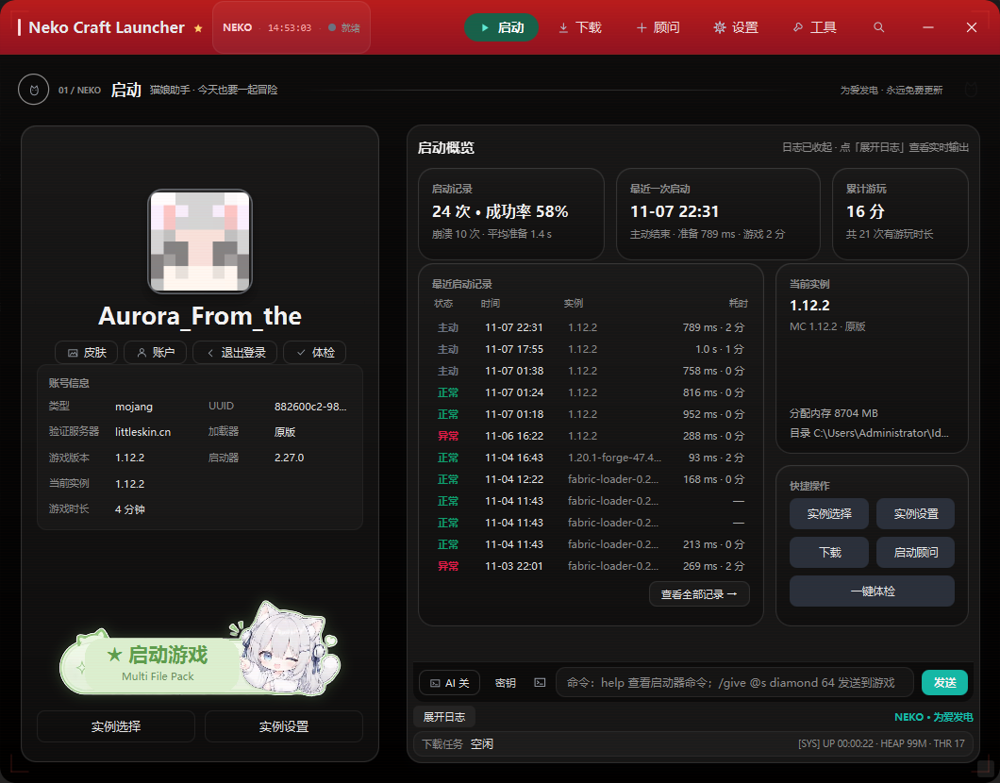
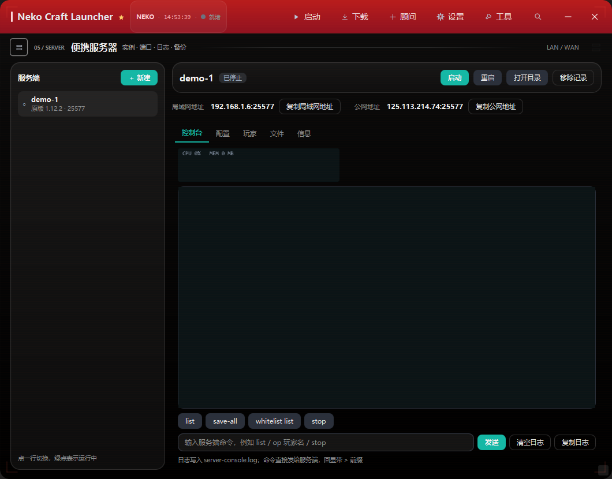

# Neko Craft Launcher 2.28.0

> 深色模式改成纯黑风格，顶栏换成红色。浅色模式也跟着换了顶栏。

## 安装包

| 文件 | 说明 |
|---|---|
| `NekoCraftLauncher-2.28.0.exe` | **安装版**：双击安装，可选目录，开始菜单 + 桌面快捷方式（按用户安装） |
| `NekoCraftLauncher-2.28.0-win64.zip` | 免安装版，解压双击 `NekoCraftLauncher.exe` |
| `NekoCraftLauncher-2.28.0-Features.pdf` / `.docx` | 功能预览（图文版） |
| `SHA256SUMS.txt` / `verify.txt` / `neko-codesign.cer` | 校验与签名材料 |

## 深色模式：暖棕 → 纯黑



原来整套是暖红棕（`#2a1014` / `#1c0b0e`），现在换成中性黑：

| 变量 | 之前 | 现在 |
|---|---|---|
| `-app-bg` | `#12080a` | `#000000` |
| `-app-root-1/2/3` | `#2a1014 / #1c0b0e / #120709` | `#0d0d0d / #070707 / #000000` |
| `-app-card` / `-app-card-top` | `#2a1418` / `#38191e` | `#161616` / `#181818` |
| `-app-panel` / `-app-surface` | `#2a1418` / `#1b0d10` | `#161616` / `#101010` |
| 文本 | `#f5e8e6`（偏粉） | `#f2f2f2`（中性白） |
| 边框 | `#3b2024`（偏红） | `#2a2a2a`（中性灰） |

一共替换 42 个主题变量，全部走 `-app-*`，所以卡片、输入框、日志面板、玻璃层、滚动条一次性跟着变。

## 顶栏：绿 → 红

- 深色：`linear-gradient(to bottom, #b91c1c, #8f1220)`，底边 `#7f1d1d`；
- 浅色：`linear-gradient(to bottom, #c62828, #991b1b)`，底边同为 `#7f1d1d`；
- 顶栏内的品牌竖条与 `NEKO` 徽标从青绿改成 `#ffe4e6` / `#fecdd3`，时钟改 `#fca5a5`，
  在红底上保持可读，也不再和红条打架。

## 服务器页在黑色下



终端、曲线、标签下划线、按钮层级在纯黑下都保持对比度；日志区 `#0b1416` 与页面底黑有区分但不过亮。

## 工程质量

- 编译 0 告警；单元测试 **327 项全绿**；文案基线 2179
- 深浅两套主题都截图核对：浅色顶栏同样变红，页面保持纯白不冲突

## 校验

```
7553047a90dc984029918176205d8495234cf452b3e7fae6f228e07b7cf75100  NekoCraftLauncher-2.28.0.exe
ebe9e1d8c59f6caeb8bcd045c730e0e0dc87560c0f5261e2d040abb5679bd9db  NekoCraftLauncher-2.28.0-win64.zip
29bbc1e15a8a423f80ae4d0957d8b9bf5353a3226b0b75305f98a8a94d7913a1  NekoCraftLauncher-2.28.0-Features.pdf
9e724c7da4a83639232882ef938460ec57e0706109fdf727de6a7eeda749fcea  NekoCraftLauncher-2.28.0-Features.docx
41bdc7658bd42ee52d59d81ccd541597b7deac9e600715ab23327227a73cdb89  neko-codesign.cer
2daedb0e6c7afed9fcbc17f49d635211e1b241e36bd3c235dbd9a068c5f6e5a2  verify.txt
```
