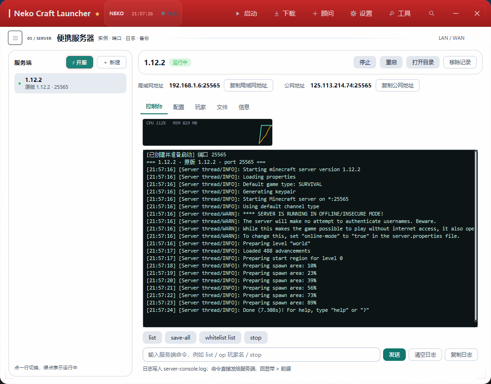
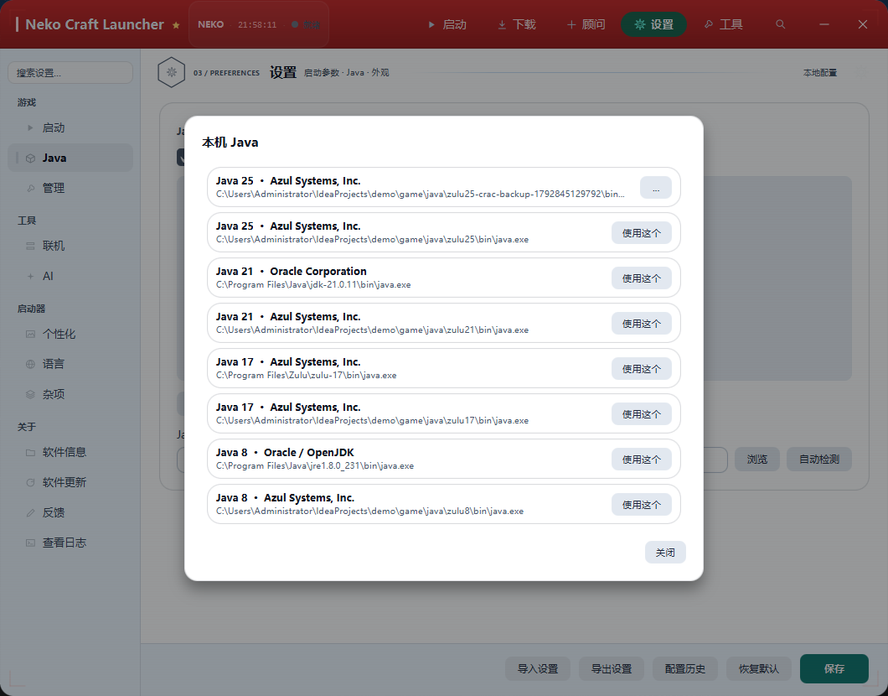

# Neko Craft Launcher 2.30.0

> 继续把「操作变简单」：开服从四步压成一次点击，Java 不用再手敲路径。

## 安装包

| 文件 | 说明 |
|---|---|
| `NekoCraftLauncher-2.30.0.exe` | **安装版**：双击安装，可选目录，开始菜单 + 桌面快捷方式（按用户安装） |
| `NekoCraftLauncher-2.30.0-win64.zip` | 免安装版，解压双击 `NekoCraftLauncher.exe` |
| `NekoCraftLauncher-2.30.0-Features.pdf` / `.docx` | 功能预览（图文版） |
| `SHA256SUMS.txt` / `verify.txt` / `neko-codesign.cer` | 校验与签名材料 |

## 1. 一键开服（⚡ 开服）



以前要：新建 → 填端口/内存/MOTD → 创建 → 等下载 → 启动。现在服务器页左上角一个按钮：

- 当前实例已有服务端 → 直接启动；
- 没有 → 自动挑端口（25565 起，跳过已占用的）、用设置里的内存、建好就启动；
- 建完自动切到该服的控制台，日志从「已创建并准备启动」开始。

实测：点一下 → 创建 1.12.2（端口 25565）→ 自动启动 →
`Done (7.308s)! For help, type "help" or "?"`，状态「运行中」，曲线显示 `CPU 212% MEM 829 MB`。

## 2. Java 自动检测



设置 → Java 新增「自动检测」：扫本机所有 JDK，列出 `Java 版本 · 厂商 · 路径`，
点「使用这个」直接写进配置（自动保存），不用手敲 `C:\Program Files\...`。

- 会过滤掉启动器自己的 CRaC 备份目录，避免误选；
- 扫不到时给一句明确提示，让你用「浏览」手选。

## 3. 顺带的一致性

- 「＋ 新建」降级成次要按钮，主动作让给「⚡ 开服」，页面上只有一个显眼的主按钮；
- 新增文案中英双语，基线 2180。

## 工程质量

- 编译 0 告警；单元测试 **330 项全绿**
- 上面两步都在真机上点过：开服跑通 `Done`，Java 列表列出 8 个运行时

## 校验

```
70b4366835e8a22c74038374c49a38aaf0c58ba356315b3ef8e880bf6567072c  NekoCraftLauncher-2.30.0.exe
6c74ba182f2d77e71e1b74625854d45d9d33820592408c24a2e9e25a5aa66511  NekoCraftLauncher-2.30.0-win64.zip
1a52a4d9f164ec7d70d124698d9d4d1d7c4a169974708bcdb966bd0ef775887b  NekoCraftLauncher-2.30.0-Features.pdf
469130ef305fbea8e4d69bd03ccdea588c7761f98e7e03a338250c701552fa90  NekoCraftLauncher-2.30.0-Features.docx
41bdc7658bd42ee52d59d81ccd541597b7deac9e600715ab23327227a73cdb89  neko-codesign.cer
b98a7095a85489625e813129d1295a81c378d51f62d04975cad1be8029d179d9  verify.txt
```
