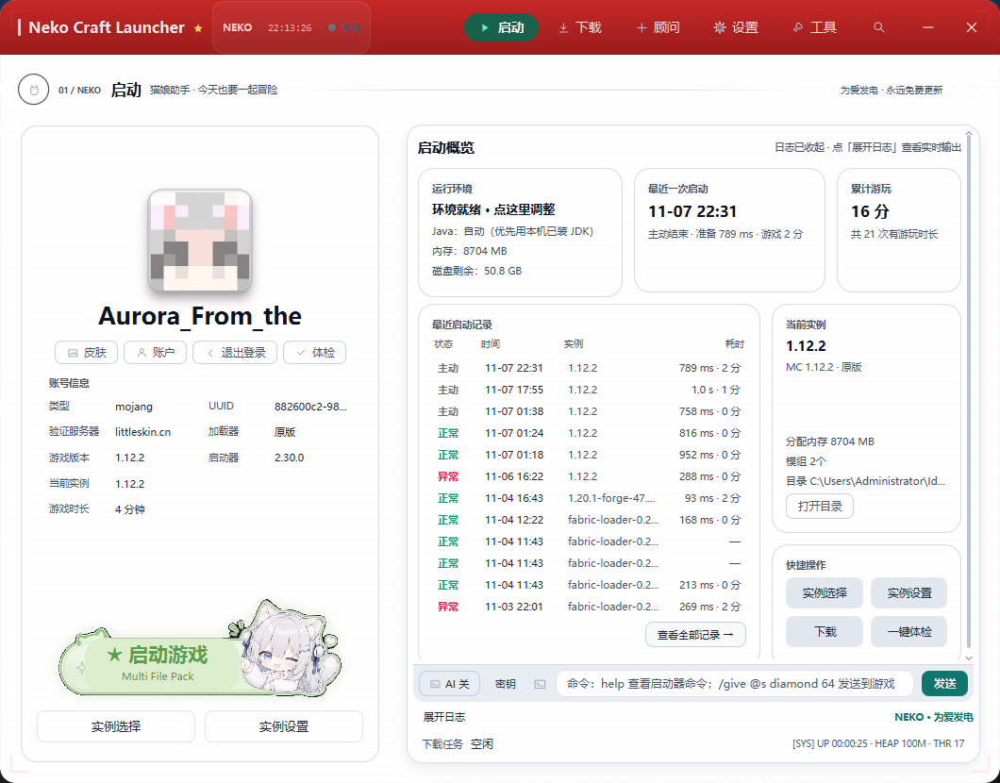

# Neko Craft Launcher 2.31.0

> 启动页的「启动概览」从看板改成能办事的：先告诉你环境行不行，再给你上次结果，实例信息补齐模组数和打开目录。

## 安装包

| 文件 | 说明 |
|---|---|
| `NekoCraftLauncher-2.31.0.exe` | **安装版**：双击安装，可选目录，开始菜单 + 桌面快捷方式（按用户安装） |
| `NekoCraftLauncher-2.31.0-win64.zip` | 免安装版，解压双击 `NekoCraftLauncher.exe` |
| `NekoCraftLauncher-2.31.0-Features.pdf` / `.docx` | 功能预览（图文版） |
| `SHA256SUMS.txt` / `verify.txt` / `neko-codesign.cer` | 校验与签名材料 |

## 概览变了什么



| 卡片 | 以前 | 现在 |
|---|---|---|
| 第一张 | 启动记录（次数 / 成功率 / 崩溃数） | **运行环境**：一行结论 + Java / 内存 / 磁盘三行实况，点卡片直达设置 |
| 第二张 | 最近一次启动 | 保留，点它直接进「一键体检」，失败时能顺着查原因 |
| 第三张 | 累计游玩 | 保留 |
| 当前实例 | 实例名 + 内存 + 目录 | 再加 **模组数量** 和 **打开目录** 按钮 |
| 快捷操作 | 5 个按钮（含启动顾问） | 4 个常用按钮：实例选择 / 实例设置 / 下载 / 一键体检 |

### 运行环境卡的三行是「能行动的」

- **Java**：`自动（优先用本机已装 JDK）` 或 `jdk-21.0.11 · Java` —— 一眼知道会不会去下载 200MB；
- **内存**：低于 2048 MB 时整行变橙色，标题改「建议调高内存」；
- **磁盘剩余**：低于 2 GB 时变红，标题改「需要处理：磁盘快满了」。

实测这台机器：`环境就绪 · 点这里调整` / `Java：自动…` / `内存：8704 MB` / `磁盘剩余：50.8 GB`。

## 顺手修的

- 概览顶部统计行高度写死 89px，塞进三行环境信息会被裁掉 —— 改成 132px，磁盘那行现在能看见；
- 「启动顾问」按钮去掉（顶栏本来就有入口），把位置让给「一键体检」。

## 工程质量

- 编译 0 告警；单元测试 **330 项全绿**；文案基线 2179
- 新增 `overview.env.*` / `overview.mods` 等中英文案

## 校验

```
4316cdfb42447c13d443da694c03671d1a667ef5797c5b67e7c8e6f997c2782e  NekoCraftLauncher-2.31.0.exe
6648ca68a5527a4c80176f9237e16da967c5fb42ca6bec35909bde4d8ce6dff1  NekoCraftLauncher-2.31.0-win64.zip
ee1776d55cca3e19f578628811fdb9a576ead5b71bc8f223c2b272f0f9977746  NekoCraftLauncher-2.31.0-Features.pdf
328d63855fd41a181f9b85eb5a09e5c9fd306b9936bb01866820b772ca5b7918  NekoCraftLauncher-2.31.0-Features.docx
41bdc7658bd42ee52d59d81ccd541597b7deac9e600715ab23327227a73cdb89  neko-codesign.cer
1e7c572ab2528767d30763a0431f8a35df69ab0b285ea1cde2ed36d2276cc7c9  verify.txt
```
