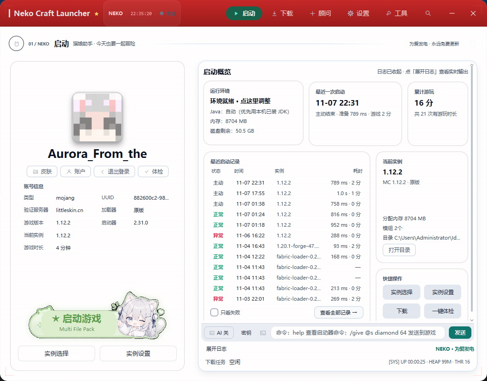
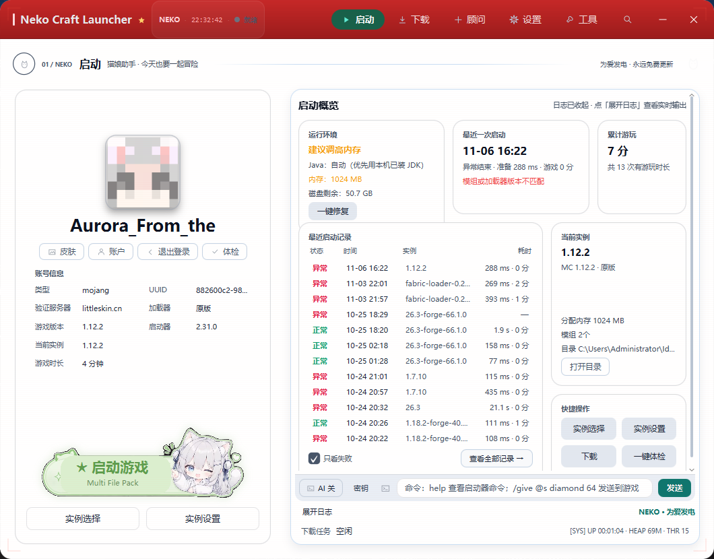

# Neko Craft Launcher 2.32.0

> 把上一版列的三件事做完：环境卡一键修复、失败给原因、记录可筛选。全部在真机上点过。

## 安装包

| 文件 | 说明 |
|---|---|
| `NekoCraftLauncher-2.32.0.exe` | **安装版**：双击安装，可选目录，开始菜单 + 桌面快捷方式（按用户安装） |
| `NekoCraftLauncher-2.32.0-win64.zip` | 免安装版，解压双击 `NekoCraftLauncher.exe` |
| `NekoCraftLauncher-2.32.0-Features.pdf` / `.docx` | 功能预览（图文版） |
| `SHA256SUMS.txt` / `verify.txt` / `neko-codesign.cer` | 校验与签名材料 |

## 1. 一键修复



内存低于 2048 MB 时，运行环境卡标题变「建议调高内存」，右上角出现「一键修复」：

- 按 `MemoryAdvisor` 的推荐值（结合模组数量）把内存调上去并保存；
- 卡片立即回到「环境就绪」，实例卡里的「分配内存」同步刷新（以前是构造时写死的旧值）；
- 磁盘不足、Java 缺失这类**修不了**的，不给按钮，只给结论。

实测：把内存改成 1024 → 卡片变橙并出现按钮 → 点一下 → `config.json` 里变成 **8704 MB**，卡片恢复绿色文案。

## 2. 失败给原因



「最近一次启动」卡多了一行红字：从 `CrashAnalyzer` 的报告里取第一条结论，
例如 `模组或加载器版本不匹配`，不用再去翻日志。

## 3. 记录可筛选

记录卡底部新增「只看失败」勾选框：勾上后只列异常记录，方便复盘。
累计游玩仍按**全部记录**统计（不跟着筛选变化 —— 这是我在测试时发现并修掉的）。

## 顺带改的舒适性细节

- 统计行高度写死导致「一键修复」被裁 → 把修复按钮并到标题行，卡片回到 140px，快捷操作也能完整显示；
- 「分配内存 / 目录」每次刷新都重读配置，不再显示旧值。

## 工程质量

- 编译 0 告警；单元测试 **330 项全绿**；文案基线 2177
- 新增中英文案：`overview.env.fix`、`overview.env.fixed`、`overview.onlyFailed`、
  `overview.instance.memory`、`overview.instance.dir`

## 校验

```
c52a79e2d8c882543c5813de655d1171a28d89c28ae8aa9222bbb6b158716d97  NekoCraftLauncher-2.32.0.exe
9f68244e6f6e75d7fa6213cc47425019e071882a1b41474afcfc3fdf0b80e8ff  NekoCraftLauncher-2.32.0-win64.zip
8c5eabb7a5455d2faa2d4dcded6f95853297f343fe72e704ba0b06d88b40d5cf  NekoCraftLauncher-2.32.0-Features.pdf
85d828cdeaac31e429943b36710466513bbc1d55ed4a4d2d65c040f4648a737f  NekoCraftLauncher-2.32.0-Features.docx
41bdc7658bd42ee52d59d81ccd541597b7deac9e600715ab23327227a73cdb89  neko-codesign.cer
b84e7f1d0f195243da852e7db199f175738afbafdd97b9761c60aca349bd8cbf  verify.txt
```
