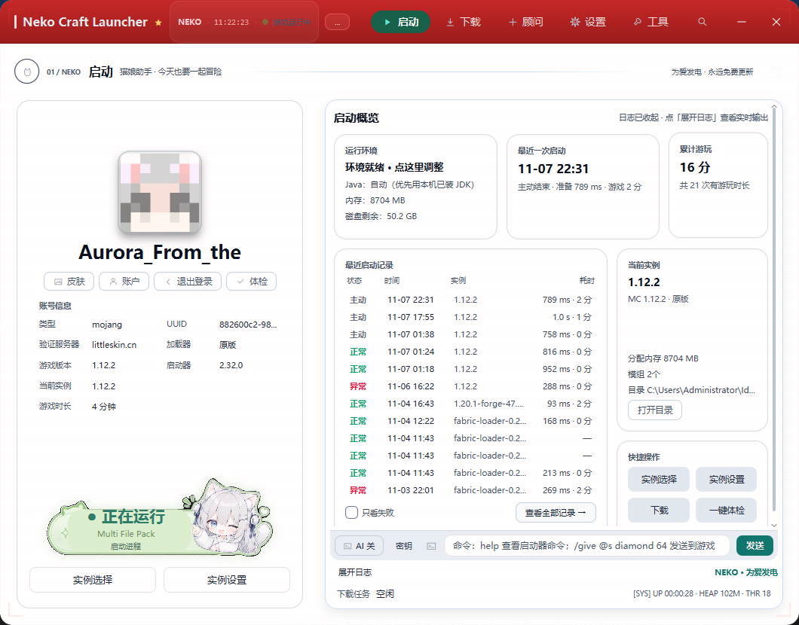
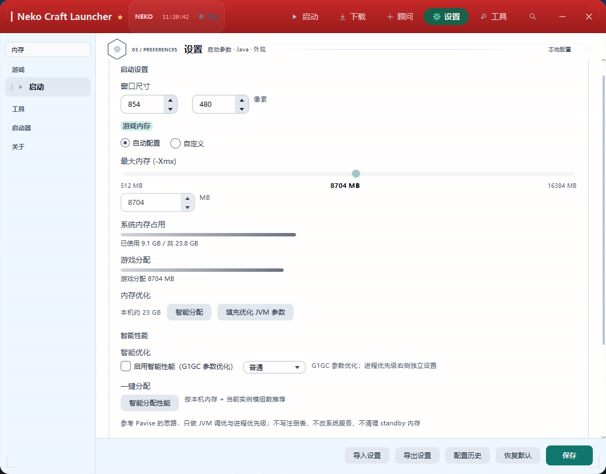

# Neko Craft Launcher 2.33.0

> 三件交互体验：启动过程看得见、设置搜索能直达、键盘能干活。

## 安装包

| 文件 | 说明 |
|---|---|
| `NekoCraftLauncher-2.33.0.exe` | **安装版**：双击安装，可选目录，开始菜单 + 桌面快捷方式（按用户安装） |
| `NekoCraftLauncher-2.33.0-win64.zip` | 免安装版，解压双击 `NekoCraftLauncher.exe` |
| `NekoCraftLauncher-2.33.0-Features.pdf` / `.docx` | 功能预览（图文版） |
| `SHA256SUMS.txt` / `verify.txt` / `neko-codesign.cer` | 校验与签名材料 |

## 1. 启动三段式反馈



主按钮下方新增一行阶段文字，配合顶栏的取消胶囊：

| 阶段 | 显示 |
|---|---|
| 解析版本 | `● 正在运行` + `解析版本`，顶栏「取消启动 · 解析版本」 |
| 校验资源 | `校验资源`（依赖库 / 资源文件校验） |
| 启动进程 | `启动进程`（准备 JVM 并拉起游戏） |
| 进程起来后 | 阶段行隐藏，只剩「正在运行」 |

以前只有一句「正在运行」，卡住时不知道卡在哪 —— 现在一眼能看出是版本解析、资源校验还是 JVM 启动。

## 2. 设置搜索直达控件



在设置页搜索框输入关键字后：

- 左侧标签按关键字过滤（原来就有）；
- 自动切到第一个命中的标签页；
- **右侧自动滚到第一个匹配项，并短暂高亮 1.4 秒**（青色背景）。

截图里输入「内存」→ 自动跳到「启动」页并高亮「游戏内存」那一行。

## 3. 键盘流

| 快捷键 | 行为 |
|---|---|
| `Ctrl + ,` | 打开设置（任何页面可用） |
| `Enter` | 启动页按回车直接启动游戏（输入框内回车仍是提交内容） |
| `Esc` | 关闭最上层弹窗 |
| `Ctrl + K` | 命令面板（已有） |

实现细节：`Enter` 的过滤放在 scene 前置阶段并 `consume`，所以焦点停在导航按钮上时也是「启动游戏」而不是触发那个按钮 —— 实测回车后按钮变成「● 正在运行 · 启动进程」。

## 测试与验证

- 三件事都在真机点过 / 按过：`Ctrl+,` 打开设置、输入「内存」看到高亮、回车触发启动并显示「启动进程」；
- 单元测试 **330 项全绿**；文案基线 2177；新增阶段文案全部走 `I18n.t`。

## 校验

```
d31c15e66801dfb5ee6eb706316a49399f8942289cfe595a0c3475fc1044190e  NekoCraftLauncher-2.33.0.exe
79593ee06eabe53ec183026bd69fea9ec64722b8e907adc59b3afe6a328496a1  NekoCraftLauncher-2.33.0-win64.zip
497b1631c99f5cc1499b453b4884d97c3ffbacfa26b5bffc73bb648654bf1ff3  NekoCraftLauncher-2.33.0-Features.pdf
2cf5d7a645f5eecda8a1ac78eae680488669144f9ea0fb6529fd3f76d3067dc7  NekoCraftLauncher-2.33.0-Features.docx
41bdc7658bd42ee52d59d81ccd541597b7deac9e600715ab23327227a73cdb89  neko-codesign.cer
cb28f268bc0fc45a4b8de0a39c91a1caada002360c4c7a73e906cb6349bdd91a  verify.txt
```
