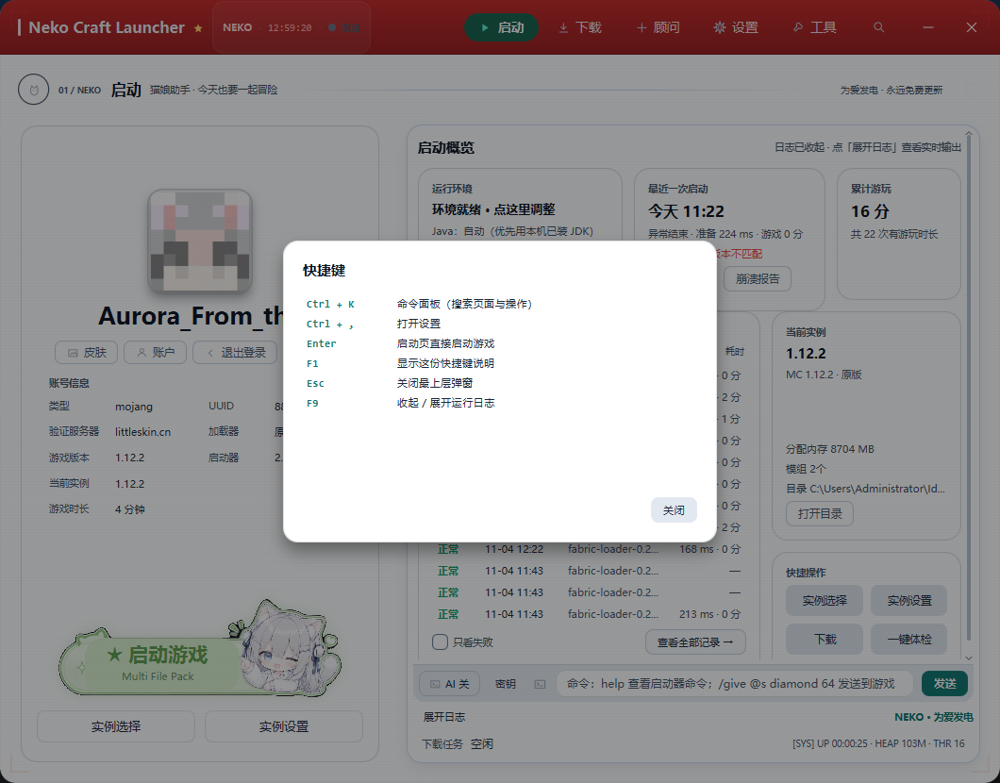
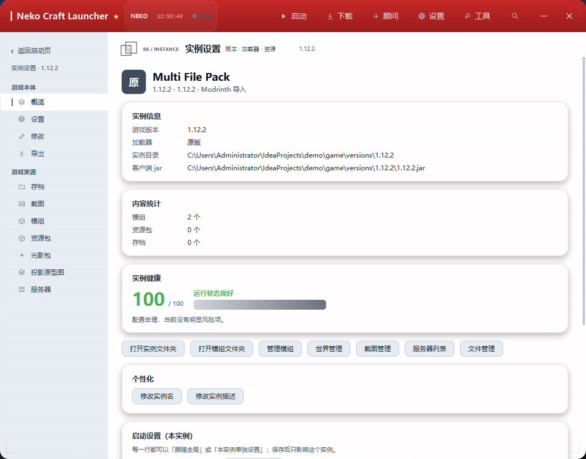

# Neko Craft Launcher 2.34.0

> 每个实例都能「单独设置」或「跟随全局」；另外补上 F1 快捷键说明和启动失败的两个直达入口。

## 安装包

| 文件 | 说明 |
|---|---|
| `NekoCraftLauncher-2.34.0.exe` | **安装版**：双击安装，可选目录，开始菜单 + 桌面快捷方式（按用户安装） |
| `NekoCraftLauncher-2.34.0-win64.zip` | 免安装版，解压双击 `NekoCraftLauncher.exe` |
| `NekoCraftLauncher-2.34.0-Features.pdf` / `.docx` | 功能预览（图文版） |
| `SHA256SUMS.txt` / `verify.txt` / `neko-codesign.cer` | 校验与签名材料 |

## 1. 实例级设置：单独设置 / 跟随全局


实例设置 → 「启动设置（本实例）」每一行都是同一个模式：

| 项 | 跟随全局时 | 单独设置时 |
|---|---|---|
| 最大内存 | 显示「全局 8704 MB」，输入框禁用 | 勾上后可直接改，带「智能分配」按模组数推荐 |
| JVM 参数 | 显示「全局：无」或全局那段参数 | 勾上后填自己的，例如 `-XX:+UseG1GC` |
| Java 路径 | 显示「全局：自动检测」或全局 java.exe 名字 | 勾上后填具体 `java.exe` |
| 游戏参数 | 显示「全局：无」 | 例如 `--width 1920 --height 1080` |
| 版本隔离 | 跟随全局 | 强制开启 / 强制关闭 |

- 「保存本实例设置」只写这个实例（存在 `versions/<id>/instance.json`，导出/复制实例时跟着走）；
- 「全部跟随全局」一键清空所有覆盖；
- 保存时日志会写明本次覆盖了什么：「内存 8704 MB / JVM 参数」。

启动时如果实例有覆盖，日志会多一行 `🎛 使用实例级启动设置（…）`，不会静默生效。

## 2. F1 快捷键说明



按 `F1` 随时弹出清单：`Ctrl+K` 命令面板、`Ctrl+,` 设置、`Enter` 启动、`F9` 日志、`Esc` 关弹窗。

## 3. 启动失败的两个直达入口



「最近一次启动」如果是异常结束，卡片上直接给：

- 失败原因（来自 `CrashAnalyzer` 的第一条结论）；
- **查看日志**：跳到日志页；
- **崩溃报告**：打开 `game/crash-reports` 目录。

## 验证

- 实例页实际打开确认：四行「单独设置」勾选框、右侧「全局 …」提示、保存/全部跟随全局按钮都在；
- `F1` 实按弹出清单；异常记录卡片上两个按钮可见（截图里那条 11:22 的异常就是测试时产生的）。

## 工程质量

- 编译 0 告警；单元测试 **330 项全绿**；文案基线 2204
- 覆盖 UI 全部走 `InstanceSettings` 既有模型，没有新增配置文件

## 校验

```
e1c37474a5287c86c93135cad97d01aaf84ad5c94efe5990e9917986a685447e  NekoCraftLauncher-2.34.0.exe
898bce8c18c87cf0f8450ba35285fc2b20a5e390ec01dfd149bb8c5bf92be917  NekoCraftLauncher-2.34.0-win64.zip
bf0fe7c927a45617c6c0348e74a90cbab02486f07e7d8b83cd3d296b95e82b06  NekoCraftLauncher-2.34.0-Features.pdf
4303421ed7bb6a1f0fc8b38aaa40d7ccc59dee6003142b84e909d685c754d271  NekoCraftLauncher-2.34.0-Features.docx
41bdc7658bd42ee52d59d81ccd541597b7deac9e600715ab23327227a73cdb89  neko-codesign.cer
6a46c6336203631295d372a9d9ea78621f87ebcf676d1c3b66ec21f002ae5108  verify.txt
```
