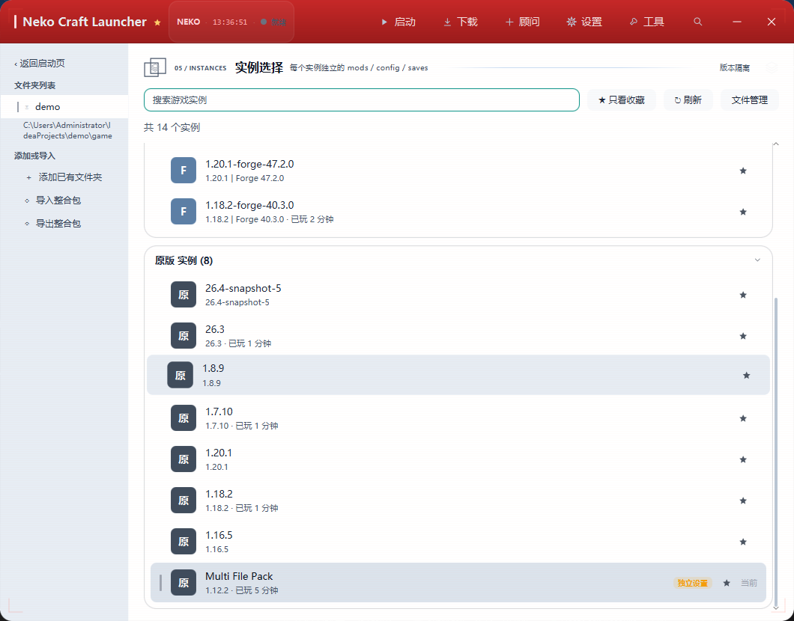

# Neko Craft Launcher 2.35.0

> 实例列表直接标出「独立设置」，不用逐个点进去才知道哪些实例不跟随全局。

## 安装包

| 文件 | 说明 |
|---|---|
| `NekoCraftLauncher-2.35.0.exe` | **安装版**：双击安装，可选目录，开始菜单 + 桌面快捷方式（按用户安装） |
| `NekoCraftLauncher-2.35.0-win64.zip` | 免安装版，解压双击 `NekoCraftLauncher.exe` |
| `NekoCraftLauncher-2.35.0-Features.pdf` / `.docx` | 功能预览（图文版） |
| `SHA256SUMS.txt` / `verify.txt` / `neko-codesign.cer` | 校验与签名材料 |

## 实例列表上的「独立设置」标记



- 有实例级覆盖的行，标题右侧出现琥珀色 **独立设置** 小标签；
- 鼠标悬停显示具体覆盖了什么：`本实例：内存 4096 MB · JVM 参数 · Java：java.exe · 强制隔离`；
- 跟随全局的实例不显示任何标记，列表依旧清爽。

判定依据就是上一版落地的 `InstanceSettings`：只要内存 / JVM / Java / 游戏参数 / 隔离任一有覆盖就会显示。

## 验证

实测流程：给 `1.12.2` 写入 `instance.json`（内存 4096 + JVM 参数）→ 打开实例选择页 →
该行出现「独立设置」标签；测试完已把这份覆盖删掉，本机配置保持干净。

## 工程质量

- 编译 0 告警；单元测试 **330 项全绿**；文案基线 2211
- 只读判定，不新增配置文件，导出/复制实例时标记自动跟着走

## 校验

```
073eb544c82e4689088088245193a2bdc3400839ff2518953facdc84f23bc0e3  NekoCraftLauncher-2.35.0.exe
3734d99e076e6a75d9132363b0b78bd2f49e63aa92d19b63818526710b5e2e98  NekoCraftLauncher-2.35.0-win64.zip
3e72f345a0eea188ebfbe0a197427900721d8e71dc49f5fbff045612ceb52d5a  NekoCraftLauncher-2.35.0-Features.pdf
a7d957b3e5f6aad542f47f5ffb71f50fbf0e3e67eec2138693f41727caf8b8b2  NekoCraftLauncher-2.35.0-Features.docx
41bdc7658bd42ee52d59d81ccd541597b7deac9e600715ab23327227a73cdb89  neko-codesign.cer
c0863e0cbc47ae9affe6502e997e588ab5e2a184f030b5bdbe429512958e9d6a  verify.txt
```
