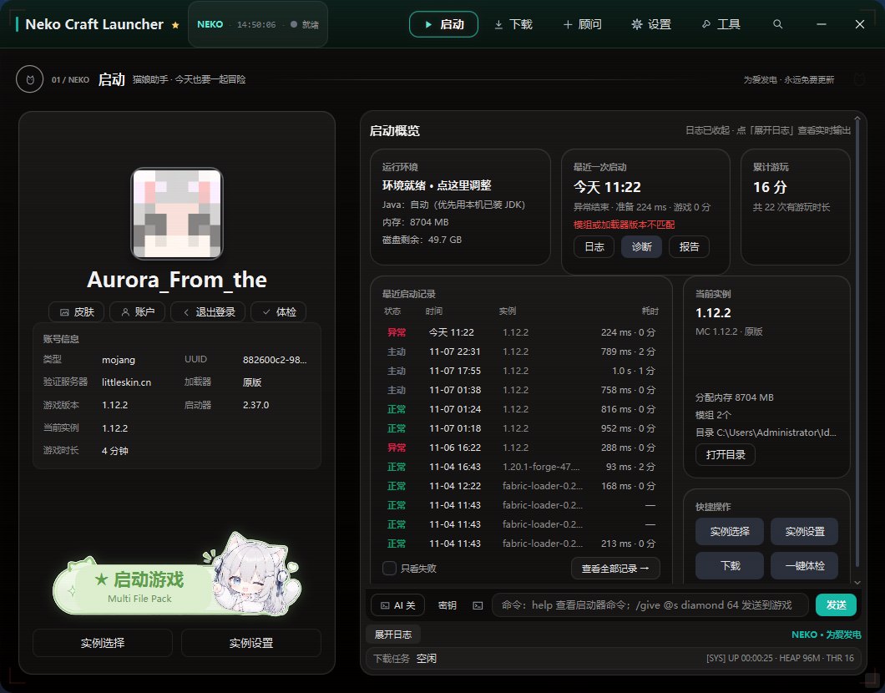
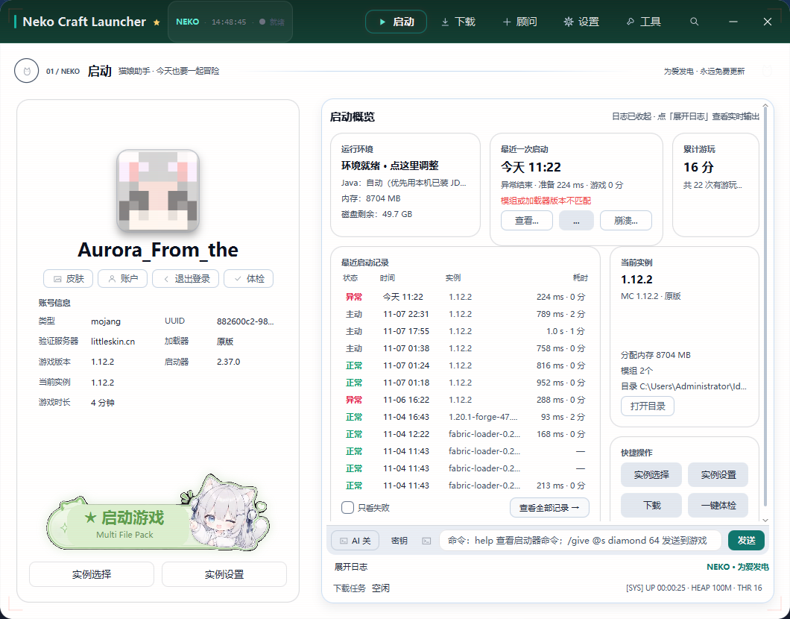
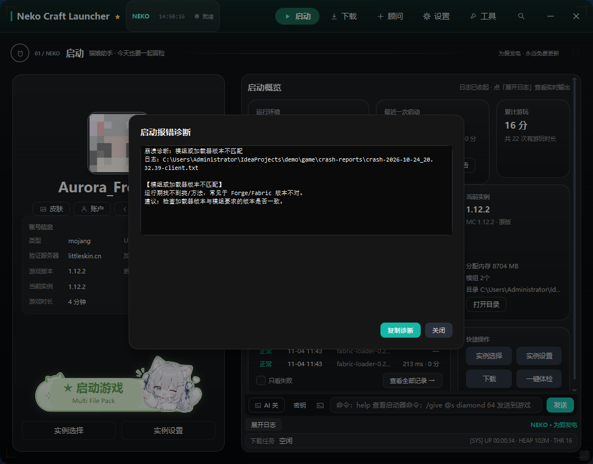

# Neko Craft Launcher 2.37.0

> 顶栏回到原来的绿色系（深色/浅色各一套灰阶），启动报错现在能一键诊断，完整 CI 全绿。

## 安装包

| 文件 | 说明 |
|---|---|
| `NekoCraftLauncher-2.37.0.exe` | **安装版**：双击安装，可选目录，开始菜单 + 桌面快捷方式（按用户安装） |
| `NekoCraftLauncher-2.37.0-win64.zip` | 免安装版，解压双击 `NekoCraftLauncher.exe` |
| `NekoCraftLauncher-2.37.0-Features.pdf` / `.docx` | 功能预览（图文版） |
| `SHA256SUMS.txt` / `verify.txt` / `neko-codesign.cer` | 校验与签名材料 |

## 1. 顶栏：回到绿色系，深浅分开

| 主题 | 顶栏 |
|---|---|
| 深色 | `#0b1f1a → #07130f`（近黑墨绿），底边 `#17392e` |
| 浅色 | `#0e2f26 → #123f33`（原来的绿），底边 `#1f5a46` |

品牌竖条 / `NEKO` 徽标 / 时钟也一并回到青绿系（`#14b8a6`、`#5eead4`、`#7b818b`），
和绿色顶栏同一套配色。两套主题一眼能看出区别：深色更沉，浅色保留原来的绿。





## 2. 启动报错检测



「最近一次启动」异常时给三个按钮：**日志 / 诊断 / 报告**（短标签，窄卡片里也放得下）。

点「诊断」弹出可复制的诊断单：

```
诊断结论：模组或加载器版本不匹配
日志：...\game\crash-reports\crash-2026-10-24_20.32.39-client.txt

【模组或加载器版本不匹配】
运行期找不到方法，常见于 Forge/Fabric 版本不对。
建议：检查加载器版本与模组要求的版本是否一致。
```

「复制诊断」一键进剪贴板，直接能贴给别人看。

## 3. 稳定性：完整 CI 跑通

`scripts\ci.ps1 -SkipBuild -Nightly`：

| 项目 | 结果 |
|---|---|
| 架构守卫 | PASS（core 不引 javafx / ui） |
| 文案基线 | PASS（2225 ≤ 2225） |
| 冒烟（5 页 + 悬停 1272 + 弹窗 + 剪贴板） | PASS |
| 圆角自检 | PASS（4/4） |
| 夜间基线 | PASS（**0.00%**） |

顶栏换色属于预期设计变更，按 CI 的提示先跑 `refresh-baseline.ps1` 更新基线，再复跑得到 0.00%。

## 4. 一致性

- 三个失败入口统一用 `btn-ghost` / `btn-secondary` + `btn-sm`，与概览其它按钮同级；
- 诊断弹窗复用 `InAppDialog`，标题/按钮风格与其它弹窗一致；
- 短标签避免窄卡片里出现「查看…」这种截断。

## 工程质量

- 编译 0 告警；单元测试 **332 项全绿**；文案基线 2225
- 新增 `overview.diagnose*` 中英文案 4 条

## 校验

```
b812568c279bfa39f28216c0f473306780feb0820dc07ff296a11820480ce772  NekoCraftLauncher-2.37.0.exe
c0155ba26f41ac484600c9423a04009f78c0f575bb5e83b41f4666c25eaf210c  NekoCraftLauncher-2.37.0-win64.zip
99cde65799141e68b84d360ef416125cc26accd8892c7f94353bb24008f33613  NekoCraftLauncher-2.37.0-Features.pdf
2a85fafb9fb06180f70fe1f48230b6c912510834e1f4de09ec010261516e436a  NekoCraftLauncher-2.37.0-Features.docx
41bdc7658bd42ee52d59d81ccd541597b7deac9e600715ab23327227a73cdb89  neko-codesign.cer
3ba86ae0b4e9450e8e675c007c0ede9c2798524bd0dbbe3d8297cf134d712268  verify.txt
```
