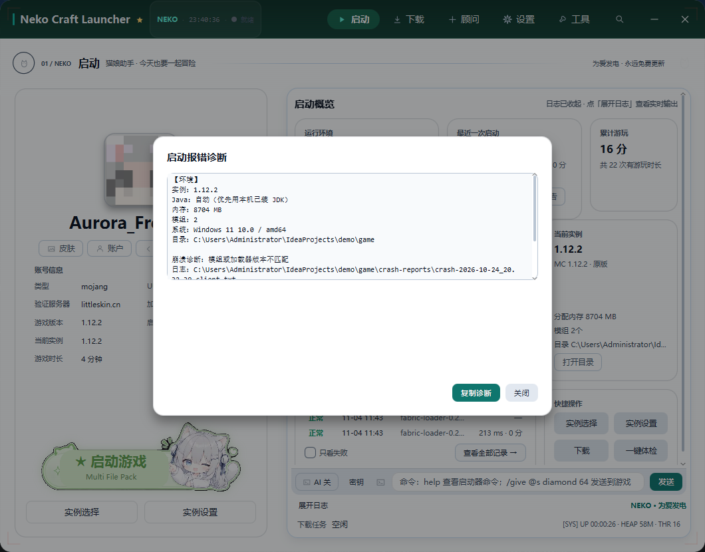

# Neko Craft Launcher 2.38.0

> CI 接进 GitHub Actions（已实跑通过），诊断单补上环境快照。

## 安装包

| 文件 | 说明 |
|---|---|
| `NekoCraftLauncher-2.38.0.exe` | **安装版**：双击安装，可选目录，开始菜单 + 桌面快捷方式（按用户安装） |
| `NekoCraftLauncher-2.38.0-win64.zip` | 免安装版，解压双击 `NekoCraftLauncher.exe` |
| `NekoCraftLauncher-2.38.0-Features.pdf` / `.docx` | 功能预览（图文版） |
| `SHA256SUMS.txt` / `verify.txt` / `neko-codesign.cer` | 校验与签名材料 |

## 1. CI 接进 GitHub Actions

新增 `.github/workflows/ci.yml`：

- 触发：push 到 `main`、PR、手动 `workflow_dispatch`；
- 环境：`windows-latest` + Temurin JDK 21 + Maven 缓存；
- 步骤：`mvnw clean package`（含 332 项单测）→ `check-architecture.ps1`（架构守卫）→
  `i18n-report.ps1 -Check`（文案基线）；
- 产物：surefire 报告与 `mc-launcher.jar` 作为 artifact 上传，保留 7 天。

**实跑验证**：手动触发 run `45039347649`，1 分 45 秒 **success**。

UI 冒烟与夜间基线仍留在本地 `scripts\ci.ps1` —— 它们需要真实桌面（截图、鼠标），
跑在 Actions 上只会误报。

### 顺手修好 release.yml

原来的 release 工作流调用 `package-inno.ps1` 并上传 `release/installer-inno/...`，
这些路径在当前管线里已经不存在了。现在：

- 版本号从 tag 解析并写进 `AppVersion.java`（写不进去直接失败，不静默）；
- 先跑单测 + 架构守卫 + 文案基线，**任何一项失败都不发版**；
- 用 `package-exe.ps1` / `package-installer.ps1`（`-SkipBuild`）产出 exe 与 zip；
- `node` 可用时生成功能文档，最后写 `SHA256SUMS.txt` 并随 Release 上传。

## 2. 诊断单加环境快照



「诊断」弹窗现在先给一段环境，再给崩溃结论：

```
【环境】
实例：1.12.2
Java：自动（优先用本机已装 JDK）
内存：8704 MB
模组：2
系统：Windows 11 10.0 / amd64
目录：...\demo\game

崩溃诊断：模组或加载器版本不匹配
日志：...\crash-2026-10-24_20.32.39-client.txt
```

以前只有崩溃结论，别人要复现还得问「你 Java 几点几、多少内存、装了多少模组」；
现在一次复制就够。

### 修的一个小 bug

第一版快照用 `` `n`n `` 拼接，PowerShell 写文件时把它当普通字符写进 Java 字符串，
结果整段挤成一行（截图里能看到 `demo"game"n"n崩溃诊断`）。改成
`System.lineSeparator()` 后正常换行。

## 工程质量

- 编译 0 告警；单元测试 **332 项全绿**；文案基线 2226
- Actions CI：run 45039347649 success

## 校验

```
4946be232d7f332e09bd261afdd88dd5f2509b6fe5a670bbb24ca96a4f55c2a1  NekoCraftLauncher-2.38.0.exe
d728ab1c2cb5a4e0edf413fcd52a5a1e4489df855f5fe34c50229d90553d9231  NekoCraftLauncher-2.38.0-win64.zip
baf5512e7d47d6c982a2fd71f6fa47820ad0817abba98d3b2bea6c581bf1d076  NekoCraftLauncher-2.38.0-Features.pdf
180605f273844807a779f2643c1ea57bd8d423a3a190ee30d45c8553e4e6bd3a  NekoCraftLauncher-2.38.0-Features.docx
41bdc7658bd42ee52d59d81ccd541597b7deac9e600715ab23327227a73cdb89  neko-codesign.cer
f734d67b745a7a50e5c2780956fc37ba4cc09df5a3c9e767de30303b834c15fe  verify.txt
```
