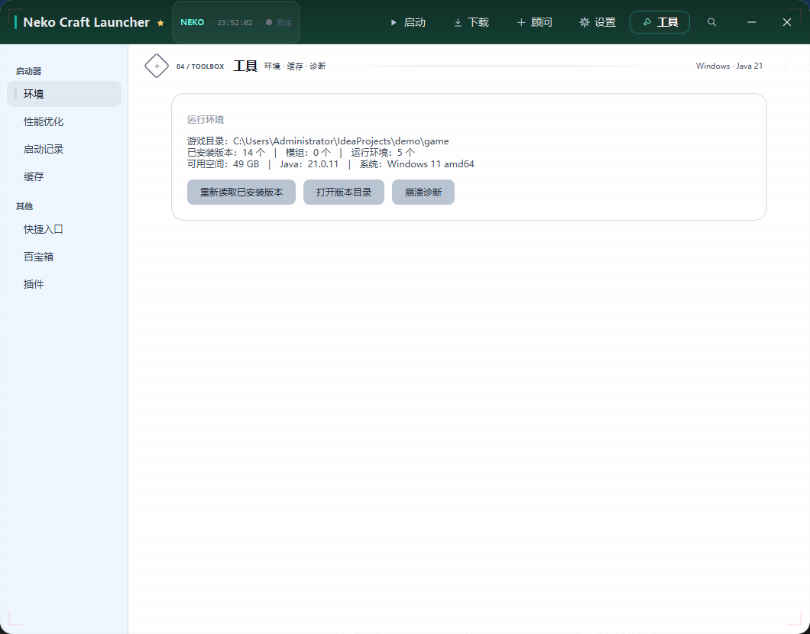
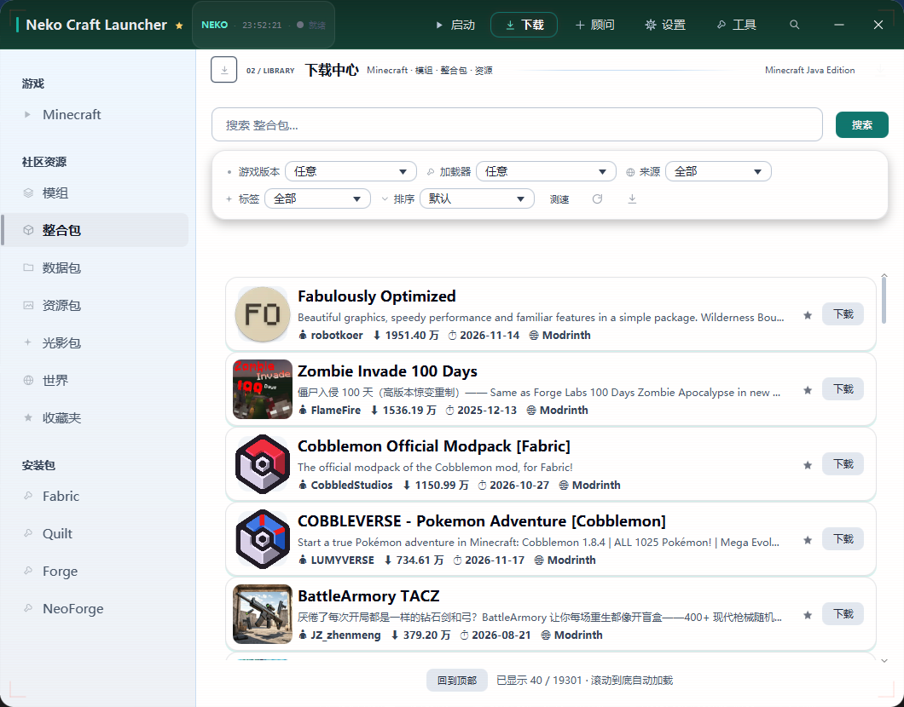

# Neko Craft Launcher 2.39.0

> 无头 UI 冒烟接进 Actions（已在 runner 上跑通六页），诊断单能导出复现脚本，浅色主题复查完毕。

## 安装包

| 文件 | 说明 |
|---|---|
| `NekoCraftLauncher-2.39.0.exe` | **安装版**：双击安装，可选目录，开始菜单 + 桌面快捷方式（按用户安装） |
| `NekoCraftLauncher-2.39.0-win64.zip` | 免安装版，解压双击 `NekoCraftLauncher.exe` |
| `NekoCraftLauncher-2.39.0-Features.pdf` / `.docx` | 功能预览（图文版） |
| `SHA256SUMS.txt` / `verify.txt` / `neko-codesign.cer` | 校验与签名材料 |

## 1. 无头 UI 冒烟进 Actions

新增启动参数 `-Dmc.smoke=1`：依次切到 下载 → 设置 → 工具 → 实例 → 顾问 → 启动，
每页等布局跑一拍（700ms）后检查可见页面尺寸是否正常，全过打印 `SMOKE DONE ok` 并退出。

CI 里的这一步（`Headless UI smoke`）带 180 秒上限，看不到标记就判失败 —— 不需要截图和鼠标，
所以在 runner 上也能跑。

**Actions 实跑证据**（run `45040760211`，verify 1m7s success）：

```
SMOKE page=download ok
SMOKE page=settings ok
SMOKE page=tools ok
SMOKE page=instances ok
SMOKE page=advisor ok
SMOKE page=launch ok
SMOKE DONE ok
```

> 第一版有 bug：切页后在同一拍就量尺寸，所有页面都是 0（顾问页报 empty）。
> 改成等一拍布局后再判断就正常了 —— 这条也写进提交记录，免得下次踩同样的坑。

## 2. 诊断单可以导出复现脚本

「诊断」弹窗多了一个按钮 **导出启动脚本**：复用 `LaunchScriptExporter`，按当前实例写出
`launch-<实例>.bat`，里面的命令行与启动器实际执行的一致（同一个 `LaunchPlanner`）。
拿到诊断的人双击脚本就能看到同样的 JVM 报错。

按钮顺序：`导出启动脚本` / `复制诊断` / `关闭`。

## 3. 浅色主题对比度复查





顶栏改回绿色后逐页看过：工具页的运行环境摘要、下载页的作者/下载量这些次要文字都是灰蓝色，
在纯白底上仍可读；没有发现白底白字或低对比按钮。标题、主按钮（深青绿实心）、正文层级都清楚。

## 工程质量

- 编译 0 告警；单元测试 **332 项全绿**；文案基线 2226
- Actions CI：push 触发 run `45040760211` **success**（含新冒烟步骤）

## 校验

```
0a0c4c9c23fb8084d70b22d8e40f7a0ea1ea09af45694b747a77c4a8b515d48d  NekoCraftLauncher-2.39.0.exe
053b7e9b45d214e85dc9d5b621c359cc56c50cfee21a4ae345379a5004e65307  NekoCraftLauncher-2.39.0-win64.zip
cbbd07cd1445c9d504fff9341ba42e080d9c4aa577552bc755ff83d672df9a01  NekoCraftLauncher-2.39.0-Features.pdf
5b79d2ef012afbd011a341c2b272ea382c2705133f4df67608e8cfb4dc0163ab  NekoCraftLauncher-2.39.0-Features.docx
41bdc7658bd42ee52d59d81ccd541597b7deac9e600715ab23327227a73cdb89  neko-codesign.cer
60d55cb52e4246588808e4d896dba17aa216080661b8a96f3da3e0ad8caa2292  verify.txt
```
